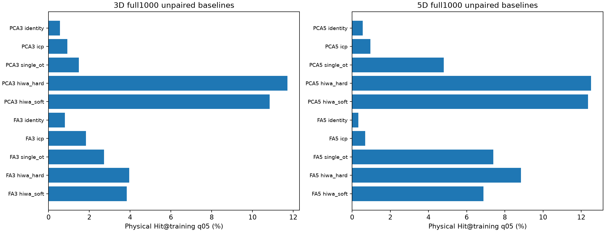

# Hyser S01/S1 五折全1000点：额外无监督对照

这些是新增实际拟合的基线；不能声称为 SA、WA 或 DAD 原论文的复现。
源、目标均仅用当前外折的四个训练试次拟合，每种方法对250测试肌电进行归纳式目标训练库检索。
测试真实五指力量只用于事后评分。表中两随机种子在同一被试同一试次上不是独立样本。

|表示|方法|有效/拟合|Hit@5%|Hit@20%|五指平均物理误差|
|---|---|---:|---:|---:|---:|
|PCA3_PCA3|identity|5/5|0.56%|14.00%|0.31506|
|PCA3_PCA3|icp|10/10|0.92%|16.96%|0.31075|
|PCA3_PCA3|single_ot|10/10|1.48%|21.92%|0.29062|
|PCA3_PCA3|hiwa_hard|10/10|11.72%|34.28%|0.25396|
|PCA3_PCA3|hiwa_soft|10/10|10.84%|33.88%|0.26199|
|FA3_FA3|identity|5/5|0.80%|18.80%|0.30216|
|FA3_FA3|icp|10/10|1.84%|23.24%|0.28812|
|FA3_FA3|single_ot|10/10|2.72%|25.36%|0.29243|
|FA3_FA3|hiwa_hard|10/10|3.96%|35.16%|0.28545|
|FA3_FA3|hiwa_soft|10/10|3.84%|33.72%|0.27095|
|PCA5_RAW5|identity|5/5|0.56%|13.68%|0.30002|
|PCA5_RAW5|icp|10/10|0.96%|28.32%|0.28689|
|PCA5_RAW5|single_ot|10/10|4.80%|29.96%|0.27878|
|PCA5_RAW5|hiwa_hard|10/10|12.52%|34.84%|0.26070|
|PCA5_RAW5|hiwa_soft|10/10|12.36%|34.12%|0.25767|
|FA5_RAW5|identity|5/5|0.32%|17.60%|0.28564|
|FA5_RAW5|icp|10/10|0.68%|18.16%|0.29323|
|FA5_RAW5|single_ot|10/10|7.40%|31.56%|0.27060|
|FA5_RAW5|hiwa_hard|10/10|8.84%|36.40%|0.26823|
|FA5_RAW5|hiwa_soft|10/10|6.88%|37.00%|0.26485|

## 解释
1. 这些是额外无监督控制，初始化与优化不等同原HiWA；非凸性导致不同种子结果不稳定。
2. 本对照的公平性在于完全相同的四试次训练、同一外折和物理评价口径；不是所有算法具备同样数学归纳偏置或计算预算。
3. 证明优于随机并不意味着优于单层OT；以表中真实数值为准。
4. 第五次试次应单独检查，且五折不能当作五位不同受试者。

