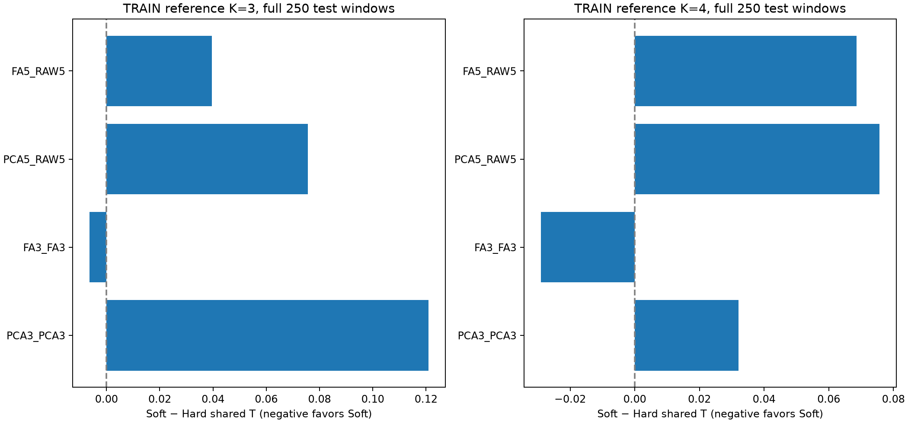

# Hyser：冻结80次HiWA模型的两层层级OT共享参考评价

**评价合同：** 参考簇分别在两域四次训练试次拟合；完整250个留出点只用于重新计算评价的P/Q，**不是**训练时学习的P/Q，也没有真实时间配对标签。
固定共同Hard KMeans参考K=3、K=4；目标是比较最终R在相同层级概率测度上的T与J，不代表Soft分组的所有表达能力。

在每个共同参考中，按 \(Q^{kl}\) 行列和分别为组内均匀条件质量、\(P\) 行列和为 \(1/K\) 的约束迭代求解。纯运输T与包含两级熵的J分开报告。

|表示|共享参考K|方法|有效/总数|T↓|J↓|T−identity↓|
|---|---:|---|---:|---:|---:|---:|
|PCA3_PCA3|3|hard|10/10|0.825658|-6.794228|-0.450718|
|PCA3_PCA3|3|soft05|10/10|0.946530|-6.681578|-0.329847|
|PCA3_PCA3|4|hard|10/10|0.686816|-11.799803|-0.535620|
|PCA3_PCA3|4|soft05|10/10|0.718919|-11.771130|-0.503516|
|FA3_FA3|3|hard|8/10|1.274442|-6.199513|-0.387689|
|FA3_FA3|3|soft05|8/10|1.268089|-6.206085|-0.394041|
|FA3_FA3|4|hard|8/10|0.996360|-11.107672|-0.775774|
|FA3_FA3|4|soft05|8/10|0.967293|-11.140487|-0.804841|
|PCA5_RAW5|3|hard|10/10|1.520944|-5.986439|-0.643679|
|PCA5_RAW5|3|soft05|10/10|1.596580|-5.905493|-0.568043|
|PCA5_RAW5|4|hard|10/10|1.150227|-11.133664|-0.890368|
|PCA5_RAW5|4|soft05|10/10|1.225953|-11.065889|-0.814641|
|FA5_RAW5|3|hard|8/10|1.731265|-5.648839|-0.931179|
|FA5_RAW5|3|soft05|8/10|1.770876|-5.607623|-0.891569|
|FA5_RAW5|4|hard|8/10|1.111419|-11.097491|-1.123601|
|FA5_RAW5|4|soft05|8/10|1.180028|-11.024827|-1.054992|

## 严格限制
- 共享参考是**事后重新优化的评价 P/Q**，不是训练末轮的原生 P/Q；原生完整训练末轮 J 因缺少已序列化的 Q 矩阵尚不能证实。
- 在两种表示、两种K比较时不能跨特征空间比较绝对T/J，仅同表示和相同参考下比较Hard/Soft。
- 本研究的测试集250目标点参与共同参考的传输评价，所以这一项是无真实对应标签的*转导式分布评价*；单点物理预测仍是归纳式目标训练库检索。
- 两种子在同一个试次上不是独立样本；对每折先取两种子平均，不能声称跨人群显著。
- K3与K4参考结果若不一致，不得挑选对Soft有利的参考冒称稳定优势。

