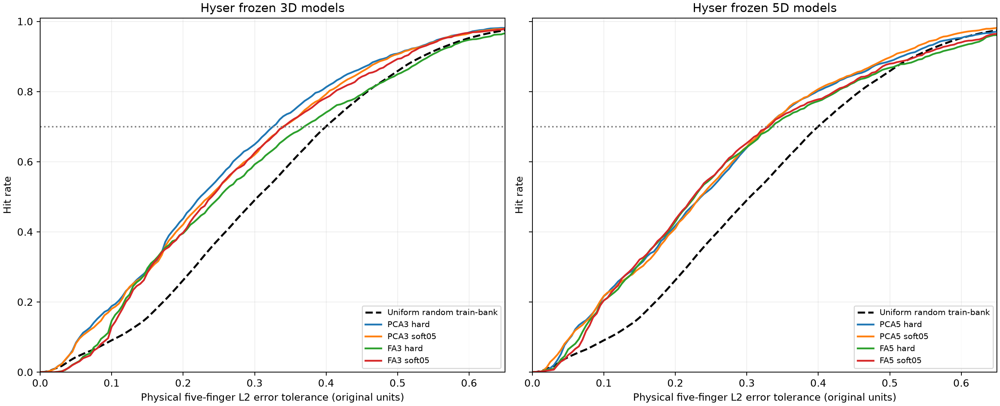
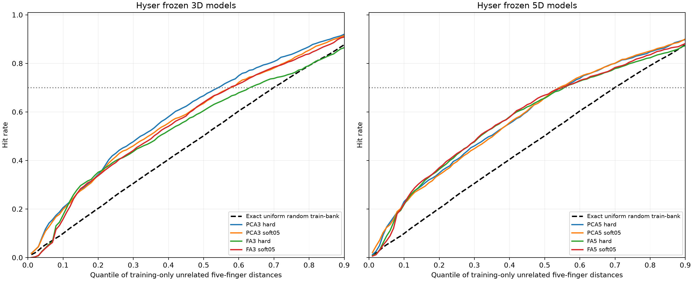

# Hyser：70% 阈值真实测量及随机基线审计

这是冻结模型上的**事后评价**，不是训练调参，不得把在外测试集上找到的70%阈值反过来用于模型选择。
每模型5个留出试次×2个随机种子×250点，共2500条预测五指力量欧氏距离。
随机基线为同一留出试次所有250个真实力量与训练库1000个目标力量的完整25万对距离；五折共125万对，**不是**训练中真实同步配对。
训练阈值由四个训练试次之间6000次独立于外测试的随机非对应力量抽样估计。

|表示|方法|达到70%所需ε|同ε模型Hit|同ε随机Hit|模型−随机|训练距离分位|
|---|---|---:|---:|---:|---:|---:|
|PCA3_PCA3|hard|0.32584|70.04%|54.28%|+15.76%|54.47%|
|PCA3_PCA3|soft05|0.33942|70.04%|57.29%|+12.75%|57.62%|
|FA3_FA3|hard|0.36928|70.04%|63.72%|+6.32%|63.67%|
|FA3_FA3|soft05|0.34099|70.08%|57.63%|+12.45%|57.97%|
|PCA5_RAW5|hard|0.32878|70.08%|54.90%|+15.18%|55.16%|
|PCA5_RAW5|soft05|0.32819|70.04%|54.77%|+15.27%|55.02%|
|FA5_RAW5|hard|0.33554|70.08%|56.40%|+13.68%|56.64%|
|FA5_RAW5|soft05|0.33096|70.04%|55.37%|+14.67%|55.59%|

## 关键限制

1. 不同试次间的表现不稳定，必须同时检查 per_trial_threshold_stability.csv。
2. 这只是在物理容忍度增大时观察到的CDF变化，70%不等于准确反演；应同时看同阈值随机基线及误差绝对量。
3. q 分位阈值只使用训练力量校准，不能用测试误差选择最优 q 再声称泛化。
4. 所有结果属于一个被试的一次会话；不能将两种子或五试次当作10位独立被试。

## 图

