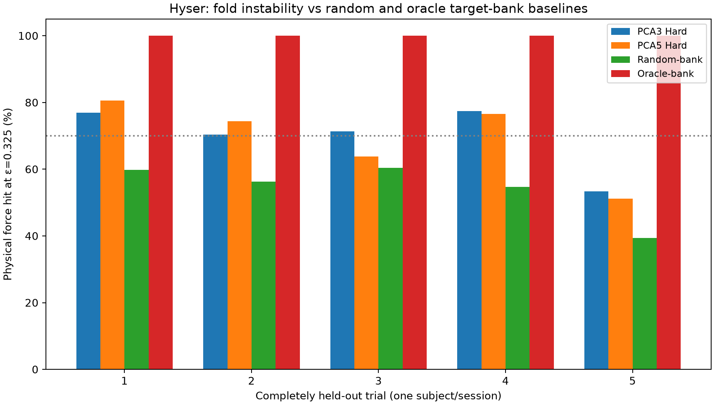

# Hyser 原始五指力量留出试次诊断：试次5困难是否源于候选库覆盖不足？

冻结的HiWA模型仅作事后检验。oracle是已知真实测试力量后在训练目标库中找到的物理最近邻；只代表训练库的理想上限，**不是**无监督模型或合理的预测方法。

随机是完整250×1000测试—训练目标力量组合的期望，不使用模型，不是 Monte-Carlo 估计。

|留出试次|PCA3 Hard Hit@ε=.325|PCA5 Hard Hit@ε=.325|随机Hit|oracle Hit|oracle平均最小误差|训练内五指中位距离|力量RMS test/train|
|---|---:|---:|---:|---:|---:|---:|---:|
|1|77.00%|80.60%|59.81%|100.00%|0.05114|0.31808|0.787|
|2|70.40%|74.40%|56.25%|100.00%|0.06733|0.30773|0.992|
|3|71.40%|63.80%|60.38%|100.00%|0.03679|0.32598|0.730|
|4|77.40%|76.60%|54.70%|100.00%|0.04126|0.30619|0.841|
|5|53.40%|51.20%|39.38%|100.00%|0.07453|0.26352|1.636|

限制：测试试次与模型同属于同一被试/会话，不能将试次5差异外推到其他被试；原始力量 RMS 和均值漂移是描述性证据，不能单独证明造成模型失配的因果机制。
若试次5的oracle仍接近100%而实际模型显著下降，表明不是训练目标库缺乏邻域，后续应重点检查跨模态映射、试次间EMG表示漂移、局部旋转与运动时滞。
