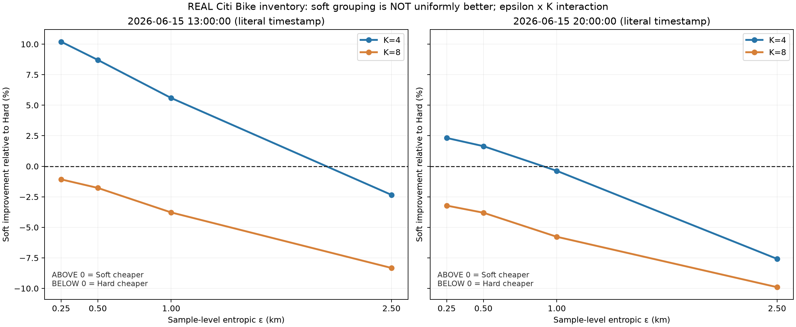
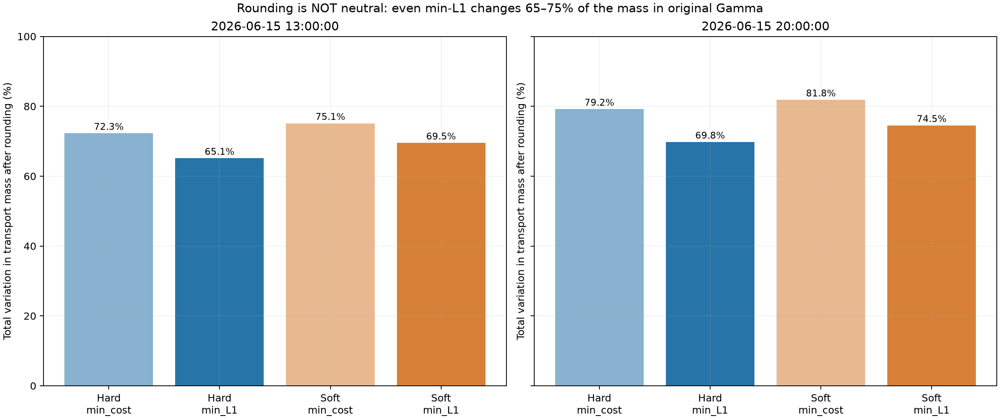

# 2026-11-20 Citi Bike actual-stock OT parameter sweep: interpretive conclusions

**This document analyses REAL computed results, not promises or synthetic data.** Original June15 historical inventory, fixed R=I, assumed HALF-FULL policy, 5,777/5,953 bikes. Only TWO same-day snapshots; not a cross-day study.

## Important discovery 1: Soft x K x epsilon interaction

Soft reduces pure transport cost relative to Hard at SMALL epsilon for K=4, but not consistently at K=8. This does not establish an intrinsic advantage in the general case.

Here positive percentages mean Soft costs **LESS** than the matched Hard configuration, negative mean Soft costs more:

| Snapshot | K | ε=.25 | ε=.5 | ε=1.0 | ε=2.5 |
|---|---:|---:|---:|---:|---:|
| 13:00:00 | 4 | +10.20% | +8.71% | +5.59% | -2.34% |
| 13:00:00 | 8 | -1.07% | -1.77% | -3.78% | -8.33% |
| 20:00:00 | 4 | +2.32% | +1.65% | -0.37% | -7.58% |
| 20:00:00 | 8 | -3.22% | -3.80% | -5.77% | -9.90% |

All 52 numerical settings on the TWO observed snapshots (20 fixed ε×K comparisons plus 12 τ scans per two snapshots), plus true exact mincost and integer b-matching audit, passed the pipeline. The exact integer baseline remains a lower bound on the same linear cost. All Q/P outputs are from separate fixed-R geographic hierarchical models; no arbitrary point-cloud rotation.

## Important discovery 2: soft temperature sensitivity

For K8 and ε=.5, reducing soft temperature multiplier toward 0.1–.25 draws Soft near Hard transport cost; making membership more diffuse (1–4) increases the cost in both snapshots. This is NOT a controlled real-world border ambiguity sweep: the station location features are fixed, only soft grouping temperature changes.

## Important discovery 3: fractional OT is NOT automatically an executable integer dispatch

The proposed floor+residual min-cost integerization legally conserves all station vehicle counts, but on THIS dense entropic plan, more than 90% of vehicles are processed by a NEW residual optimizer; this optimization can overwhelm the original algorithm's choice of Gamma. Cost-after-rounding is therefore not direct evidence about Hard vs Soft.

Even the **minimal-L1** integerizing b-matching changes most pairwise transport:

| Stored snapshot | Model | Min-L1 integer cost (bike-km) | Changed total transport mass (TV) | Min-cost rounding TV |
|---|---|---:|---:|---:|
| 2026-06-15 13:00:00 | Hard | 14548.33 | 65.1% | 72.3% |
| 2026-06-15 13:00:00 | Soft | 13562.44 | 69.5% | 75.1% |
| 2026-06-15 20:00:00 | Hard | 15577.15 | 69.8% | 79.2% |
| 2026-06-15 20:00:00 | Soft | 15580.16 | 74.5% | 81.8% |

A lower integer cost can be entirely due to new min-cost rounding, not the unmodified hierarchical Gamma. The outcome is a diagnostic showing that dense Sinkhorn transport needs sparsification / integer feasibility IN the design, not a proof that the method yielded real dispatch savings.

## Next independent scientific experiment

1. Define structural why-K4-soft-helps: separate P-level routing from conditionally forced Q-level routing under fixed epsilon; compare a capacity-aware integer hierarchical flow against the flat exact mincost, holding all mass/route constraints constant.
2. **Do not tune on July validation / August-September heldout** until the design and performance metrics are frozen; two same-day windows are not statistically independent.
3. Use multiple genuinely independent dates; report confidence intervals on Soft−Hard effects and on matching flow mass / boundary station role; do not pick a visually attractive parameter post hoc.
4. City-wide full network source count is per snapshot (hundreds of supply/deficit stations), not 18.87 million OT nodes. Real road routing and operator demand absent; current cost uses great-circle bike-km proxy.
5. SA/DAD original versions are geometric alignment methods and **not** meaningful direct fixed-geography dispatch baselines. WA with fixed R=I is flat Sinkhorn. There is no SA/DAD score in this transport study.
