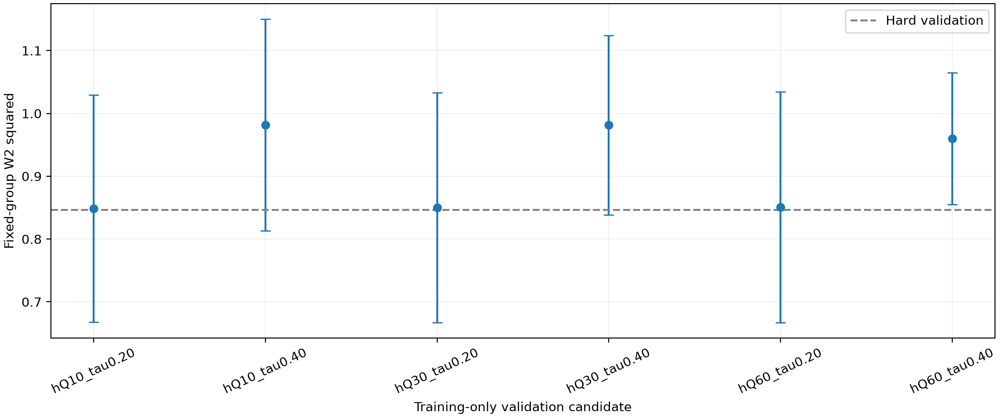
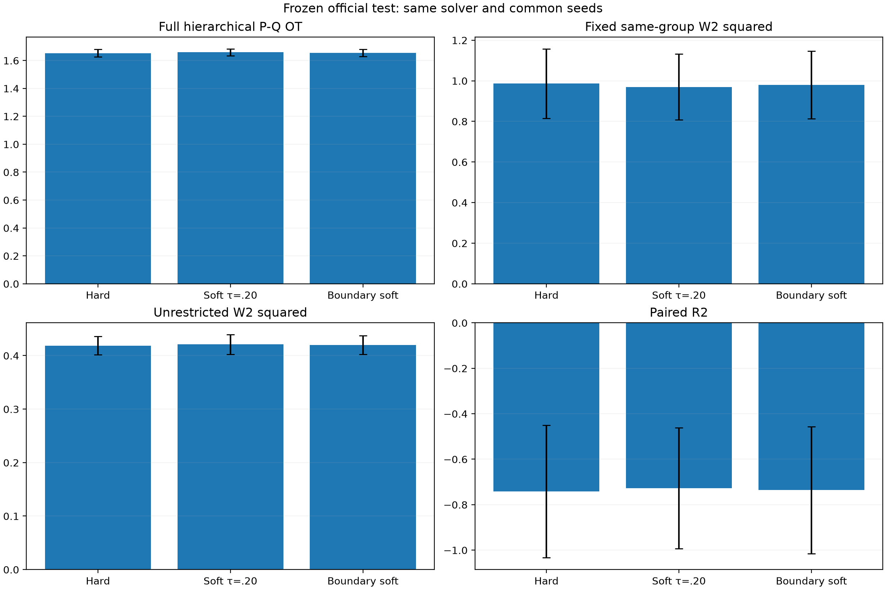
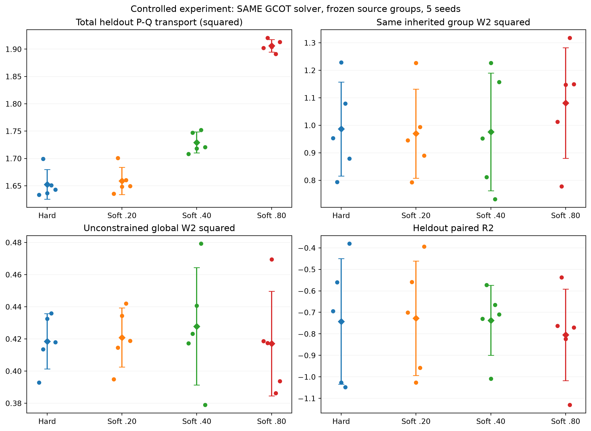
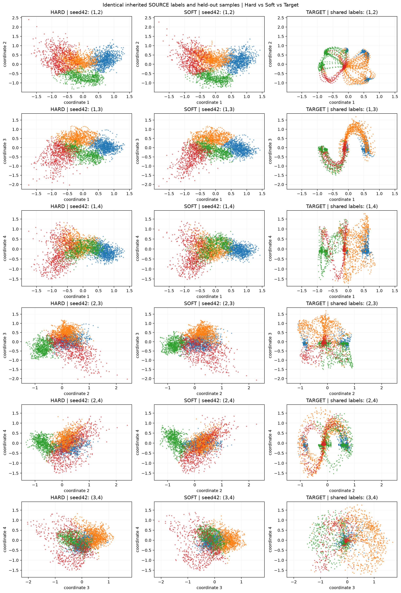
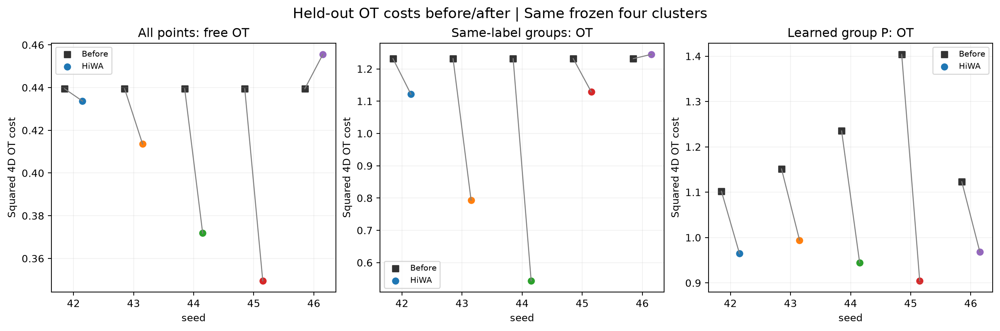

# 实验日志（持续更新）

## 2026-11-17 · 实验 G：Boundary-Adaptive Soft (内部验证独立选参)

**研究问题**：只在 K-means 边界附近提高软隶属度，而组内部保持接近硬分配，能否在一个求解器与相同组标签下改善完整分层 OT 和固定同组 OT？

设置：源域原 4D K-means K=4 一次，目标不聚类，目标权重直接由同步源继承；设 Δ=第二最近中心距离平方−最近中心距离平方，α=exp(−Δ/h)，A=(1−α)onehot+α distance-softmax(τ)。
对原400个训练试次划 320/80 内部训练/验证，验证3 seeds、6 candidate，由**内部验证固定同组 OT**选 h/τ；原100测试试次仅用于最终5 seeds评估。

选中内部验证参数：hQ10_tau0.20（h=0.209933,τ=0.20）。

| 方法 | 测试 P-Q 总 OT↓ | 固定同组 OT↓ | 全域 OT↓ | R²↑ |
|---|---:|---:|---:|---:|
| Hard | 1.65257 | 0.98655 | 0.41854 | -0.74185 |
| 固定 Soft τ=.20 | 1.65883 | 0.96980 | 0.42092 | -0.72735 |
| Boundary soft | 1.65493 | 0.97898 | 0.41977 | -0.73633 |

新方法最终数值审计：5/5，其含义为满足预设数值残差阈值，不是全局最优证明。
**内验证依赖旧400训练试次拟合的原型、PCA和归一化，不是完全嵌套的无监督表示学习验证**；原100试次测试集依然封存到选参之后。

[完整正式报告](results/boundary_adaptive_trial_cv/BOUNDARY_ADAPTIVE_REPORT.md)

---

## 2026-11-17 · 实验 F：严格 Hard–Soft 单求解器温度消融与完整 P–Q 总传输代价

核心研究问题：在**仅有一次源域 K-means 分组并保持全部标签不变**时，仅将一对一 hard 组隶属度变为温度控制的 soft 隶属度，是否能够降低两层 OT 的实际几何代价？

本轮在同一 GCOT 算法、相同训练样本/初始化/迭代预算和同一留出测试集上完成 4×5=20 次实测，全部通过数值审计。目标成员关系按原实验同步神经/运动点索引从源域继承。outer=500，inner=20，sample Sinkhorn=45，K=4，40点/组的训练池，组级熵0.2、局部熵0.1、mu=0.05。

## 最新正式控制变量研究：同一求解器下 Soft 温度与总分层 OT

此次使用**完全相同的用户 ZIP 中 GCOT 分层 OT 求解器**（不是把原版 PyHiWA 直接与 GCOT 相比），同一 DANDI 000138 四维数据、唯一源域 K-means 四个原型、相同训练/测试划分、相同 160 点训练池、5 个种子与相同初始化。仅改变组成员关系：**Hard one-hot 或源原型距离 softmax（τ=0.20/0.40/0.80）**。目标软隶属度按真实同步索引继承，没有额外目标域 K-means；变换后也不重新分组。

本次首次对同一求解器统一计算**完整分层总传输几何代价**：\(\sum_{ij}P_{ij}\langle Q_{ij},\|Rx-y\|^2\rangle\)。测试时冻结训练求得的组级 \(P\)，在同一批留出测试点上通过原版 Sinkhorn 重新优化各组对 \(Q_{ij}\)，**不把熵项混入几何代价**；该指标允许跨组输运，区别于独立计算的「固定同编号组 OT」。总传输代价单独采用每域四组各32个测试样本；固定同组 OT 使用每组128个、全域 OT 使用200个点，三种问题及采样设置不同，**不可直接比较数值大小**。

| 相同 GCOT 求解器 | 总 P-Q OT 传输前 ↓ | 总 P-Q OT 传输后 ↓ | 固定同组 OT ↓ | 全域 OT ↓ | R² ↑ | 数值审计 |
|---|---:|---:|---:|---:|---:|:---:|
| Hard one-hot | 1.84457 ± 0.11774 | **1.65257 ± 0.02705** | 0.98655 ± 0.17106 | 0.41854 ± 0.01722 | -0.74185 ± 0.29195 | 5/5 |
| Soft τ=0.20 | 1.83751 ± 0.10973 | **1.65883 ± 0.02489** | 0.96980 ± 0.16222 | 0.42092 ± 0.01838 | -0.72735 ± 0.26579 | 5/5 |
| Soft τ=0.40 | 1.85479 ± 0.06809 | **1.72925 ± 0.01924** | 0.97591 ± 0.21394 | 0.42786 ± 0.03653 | -0.73686 ± 0.16337 | 5/5 |
| Soft τ=0.80 | 1.93353 ± 0.00516 | **1.90621 ± 0.01131** | 1.08109 ± 0.20117 | 0.41710 ± 0.03261 | -0.80493 ± 0.21280 | 5/5 |

**熵项不能替代传输误差。** 原作者目标函数带有 \(\sum Q\log Q\) 形式的熵项，Hard/Soft 有效支持不同，原始负熵基准也不同。下面将训练几何代价、原始含熵目标及额外的 KL 修正指标分别列出，避免将原始目标「越负」误判为实际传输「越好」：

| 模式 | 训练 P-Q 几何代价 ↓ | 训练原始含熵目标 | 测试 KL 修正目标（scaled） | 软分组归一化熵 |
|---|---:|---:|---:|---:|
| Hard one-hot | 1.55427 ± 0.05576 | -11.91206 ± 0.02141 | 0.47300 ± 0.00917 | 0.0000 |
| Soft τ=0.20 | 1.56126 ± 0.05733 | -12.11974 ± 0.05099 | 0.47332 ± 0.00841 | 0.0486 |
| Soft τ=0.40 | 1.63363 ± 0.06929 | -13.05755 ± 0.06791 | 0.48184 ± 0.00730 | 0.2677 |
| Soft τ=0.80 | 1.84350 ± 0.07503 | -15.58207 ± 0.04603 | 0.49778 ± 0.00104 | 0.8403 |

**阶段性结论：**五个种子全部通过预设的最终数值残差审计。在**测试 P-Q 总传输代价**上 Hard one-hot 最低，Soft τ=0.20 非常接近，较大的温度 τ=0.40/0.80 反而明显增大代价。若只看固定同组 OT，Soft τ=0.20（0.96980）比同求解器 Hard（0.98655）略低，但五种初始化不足以证明统计优势。

**严格限制：**温度网格是探索性敏感性分析，不能将测试集上最优温度当作经独立验证的超参数；本方法由于沿同步试次传播目标组隶属度，仍含有组信息监督；这一 Soft 是固定源 K-means 原型的连续分配，而非原版 TPAMI 分别学习两域原型的完全无配对 GCOT。

[完整对照报告](results/controlled_hard_vs_soft_PQ/CONTROLLED_ABLATION.md) · [每种方法每个种子的 R、P、分层 Q 传输代价与各种误差](results/controlled_hard_vs_soft_PQ/CONTROLLED_ABLATION.json) · [可复现运行代码](code/run_controlled_soft_hard_ablation.py) · [原始 ZIP GCOT 源码快照](code/zip_gcot/)

---

**本轮关键问题发现：**训练原始含熵目标会随 Soft 温度升高变得更负，但将熵项剥离后的实际测试 P-Q 总几何代价反而上升。因此在软组有效支持与边际权重不同的情况下，直接以带熵总目标数值判优会误导。后续研究可仅使用训练/验证集选温度，测试集只作最终确认；另行研究是否强制 P 对角化，以适配“固定组一一对应”的建模目标。

---

## 2026-11-17 · 实验 E：仅源聚类一次的 Soft-GCOT 对照

软隶属度由源域唯一 KMeans 中心按距离 softmax 计算，目标由同步时窗继承，算法采用用户压缩包的原版 GCOT 分层 OT 代码。使用同一四维输入、相同 K=4 组来源、测试分割、OT 评价、5 seeds和训练迭代上限500。

软隶属度归一化熵 0.2677，数值审计通过 5/5。

- 全域 OT W2²：Hard 0.40482 / Soft 0.42786
- 固定同组 OT W2²：Hard 0.96642 / Soft 0.97591
- R²：Hard -0.60738 / Soft -0.73686
- MAE：Hard 0.49767 / Soft 0.52215

详情：[Soft-Hard 对照报告](results/soft_fixedgroup_vs_hard/SOFT_HARD_COMPARISON.md)。注意算法实现有差异，不可完全归因于软分组本身；该变体使用同步对应传播目标组信息。

---

## 2026-11-17 · 冻结模型最优传输代价重新评价

在同一次唯一源域 KMeans、固定组标签与外迭代 500 次的原版 HiWA 上，只读取已存 R、P 而不重新训练。
计算全域无约束精确 OT、同编号组精确 OT、学得 P 的跨组加权 OT；详见 [OT_EVALUATION.md](results/source_only_fixed_groups_outer500/ot_evaluation/OT_EVALUATION.md)。

| 检验 | 原始 | HiWA 后五次平均 |
|---|---:|---:|
| 全域自由 W2² | 0.439478 | 0.404823 |
| 固定同组 W2² | 1.231750 | 0.966421 |

第三项使用原版已学习 P 对各组间测试 OT 代价加权，但不是原版训练精确目标：旧文件没有局部 R_ij、Q_ij、C_ij。
同编号组 OT 不允许跨组，而原版 P 往往仍有非对角质量；这两个问题应当分开评价。

---

## 2026-11-17 · 实验 D：唯一标签、原版 HiWA 延长 500 次迭代

仅最大外迭代数从 140 增为 500，源域一次 KMeans、目标标签继承与全部其他超参数不变。

收敛审计通过的 seed：[42, 43, 44, 45, 46]；五次均值 R²=-0.60738。详见 [延长迭代的收敛报告](results/source_only_fixed_groups_outer500/CONVERGENCE_REPORT.md)。

---

## 2026-11-17 · 实验 C：只聚类源域，唯一组标签贯穿三个点云

**现行最新协议（旧两域独立 K-means 结果仅作历史）。** 源 4D K-means 一次，目标同一时间窗继承标签，Hard HiWA 只旋转源坐标，前后不重新分组。配对标签继承带有监督信息。

四组训练样本数为 [4137, 4316, 3146, 2401]；详见 [正式实验结果](results/source_only_fixed_groups/RUN_REPORT.md)。

1NN：37.31%；MAE：0.50042；配对 rMSE：1.61274；R²：-0.61619。

[原始源域](results/source_only_fixed_groups/source_before_test_six.png) / [继承标签目标域](results/source_only_fixed_groups/target_shared_test_six.png) / [旋转后源域](results/source_only_fixed_groups/source_after_test_six.png) / [三域直接比较](results/source_only_fixed_groups/before_after_target_six_pairs.png)。

---

## 2026-11-17 · 问题诊断与 LaTeX 报告（重要更新）

**报告（项目根目录）：** [《四维 Hard HiWA 实验与问题诊断》PDF](四维HardHiWA实验与问题诊断.pdf) · [XeLaTeX 源码](四维HardHiWA实验与问题诊断.tex)。报告使用原始两张六投影聚类图，记录数据来源、处理步骤、冻结参数、两项 HiWA 指标及附加诊断。原版 `code/hiwa_original.py` **未修改**。

### 新增诊断（不属于 HiWA 本身的性能评价）

在与 Hard HiWA 相同的神经 4D PCA、手部原生 4D 变量及 400/100 trial-disjoint 划分上，使用训练同步配对建立**仅供诊断**的监督对照：

| 训练配对拟合／评价方式 | 留出 100 trials 的标准 R² |
|---|---:|
| Identity，未对齐 | -0.7965 |
| 无监督 Hard HiWA，5 seeds 均值 | -0.8947 |
| 有监督正交 Procrustes | -0.0604 |
| **有监督一般线性 Ridge（same-time）** | **0.2868** |

Ridge 的 4×4 矩阵奇异值约 `(0.861, 0.459, 0.295, 0.111)`，而严格正交矩阵的奇异值必须全为 1。这是**非等距几何结构/正交约束过强**的定量证据。Ridge 相同时间窗口的 test R² 按 100 个独立试次重采样 bootstrap（1,000 次）95% 区间约 `[0.259, 0.307]`，仅供稳健性检查。

**时序诊断：** 固定目标评价窗口为相对 `move_onset_time` 的 **110–390 ms**，训练试次内部再划分 320/80 的拟合/验证，比较神经领先/落后目标 ±200 ms 的 20ms 步长。在训练验证上选择到 **神经领先手部运动 140ms**（validation R² 0.3875），固定该选择的留出测试 R² **0.3902**。100 次独立打乱测试试次的负对照 R² 均值约 -0.334。**这不是已确认的生理传导时延，不是新的 HiWA 结果**；需控制任务时间和速度/位置分量。

**分组诊断：** 源域 KMeans 组质量 `(29.6%,30.8%,22.5%,17.2%)`，行为域 `(20.1%,45.1%,14.4%,20.4%)`，而原版 HiWA 硬编码簇边缘质量 `(25%,25%,25%,25%)`。依靠同步时间标签仅做事后检查，最佳一对一簇置换覆盖约 **51.1%** 的训练时窗，反映组间并无清楚的一一关系。HiWA 5 个 seed 得到的簇置换覆盖率分别为 32.0%、50.8%、28.7%、24.2%、17.7%；seed 42 学到 `det(R)≈-1` 的反射（原版 O(4) 合法），表明分组与映射都有多解/不稳定风险。

**结论（事实、解释区分）：** 已证实同一 4D 神经表征包含可预测运动的线性信息；但是原版硬分组 HiWA 得到的正交解没有转化为可靠同步预测。这支持优先研究**几何等距约束、神经—行为时间配准、等簇质量假设、神经表示**，而不能直接断言求解器有代码错误或软分组一定优于硬分组。

**诊断代码与数值：** `code/diagnose_hiwa.py`、`code/diagnose_fixed_window_lag.py`、`code/diagnose_group_structure.py`；`results/diagnostics/diagnosis.json`、`fixed_window_lag.json`、`group_geometry.json` 及对应 PNG。旧的 NRMSE 仍仅用于历史追溯，**未来主要质量评价保持原版 rMSE（真实数据只能做代理值）与修正公式的标准 R²**。

下一步计划：在同一测试集上独立测试时间配准后的原版 HiWA（固定时间窗口）、检验 `K` 与非均匀组质量消融、以及 4D PCA 表示损失的影响。**以上下一步尚未执行，不应与当前已完成诊断混同。**

---

## 2026-11-17 指标口径纠正：以后只使用 HiWA 的 rMSE 与 R² 作为主评价

**本节取代下文 2026-11-17 旧记录中两类 NRMSE 的性能判定。** 使用原有 400/100 trial 分割、相同四维表示和固定归一化、seed 42–46，**没有重新训练 HiWA**。原始 `code/hiwa_original.py` 保持不变。

- 原版 `_rMSE(X,R,Rgt)=||Rgt Xᵀ-R Xᵀ||²_F/||Rgt Xᵀ||²_F` 需要实际的真值旋转 `Rgt`。DANDI 000138 不提供 `Rgt`，因此仅报告**rMSE 代理值**：用训练试次已知同步配对拟合的有监督正交 Procrustes 作为参照 `R_ref`；这个参照**不参与 HiWA 无监督拟合**，且**不能等同真实 rMSE**。
- 原版 `_eval_R2` 存在公式实现问题（用了有符号平均误差而非平方残差）。不修改原版求解器，但按标准多元 **R² = 1 − SSE/SST**（`SSE=sum_test ||y_i−R x_i||²`，`SST=sum_test ||y_i−mean_test(y)||²`）在留出测试集评分。
- ADMM 共识/正交性/OT 边缘检查保留为**数值合格性检验**，不再作为额外的“预测评价指标”。

| 参照方法 | rMSE（代理，越低越好） | 标准测试 R²（越高越好） |
|---|---:|---:|
| Identity（未对齐） | 1.96470 | -0.79649 |
| Hard HiWA，5 seeds 均值 ± 样本标准差 | **1.91621 ± 0.37054** | **-0.89472 ± 0.22508** |
| 有监督训练配对 Procrustes（只作为诊断） | 0（定义所致） | -0.06044 |

| HiWA seed | rMSE 代理值 | 标准 R² |
|---:|---:|---:|
| 42 | 2.11824 | -0.80478 |
| 43 | 1.26308 | -0.54862 |
| 44 | 2.09887 | -1.09933 |
| 45 | 1.97163 | -0.95505 |
| 46 | 2.12925 | -1.06582 |

**结论：** rMSE 代理值五次平均稍微降低，但随机性很大；真正可解释为测试集运动预测的 R² 五次都是负的，平均比未对齐还差。监督训练参照的测试 R² 也稍低于 0，提示四维全局正交假设值得优先检验。不能断言找到真实旋转，也不能从这次实验得出 Soft 优于 Hard。

**复现**：`python code/evaluate_hiwa_two_metrics.py --clusters results/clustering/clustered_4d.npz --alignment results/hard_hiwa/hard_hiwa_results.json --output results/hard_hiwa/hiwa_rmse_r2_evaluation.json`。新实验推荐 `code/run_hard_hiwa_2metric.py`，从原版 runner 的保存结果自动计算这两项。旧的 NRMSE JSON/图仅作为历史记录保留，**不用于以后的主结论**。

---

**最新：2026-11-17**。本页用于快速恢复项目进度。原始 NWB 不入仓库；所有固定输入、中间图和 Hard HiWA 原始数值见 \`results/\`。实验只回答原版硬分组基线，尚未测 Soft-GCOT。

## 明确研究问题
1. 四维神经表征和原生四维手部运动是否具备可识别的簇结构？
2. Hard HiWA 在数值上**真正收敛**后，能否降低两个域的**无配对分布**误差？
3. 这种分布匹配能否恢复**逐时刻神经—行为对应**？需要哪些几何/动态条件？

## 实验 A：KMeans(4)，真实 NWB
DANDI 000138 (0.220113.0407), \`sub-Jenkins_ses-large_desc-train_behavior+ecephys.nwb\`，500 trials，训练/测试 400/100（窗口 14000/3500）。神经 162 units → PCA4（前四轴累计解释约 13.06%）；行为保留 (pos_x,pos_y,vel_x,vel_y) 四维，无行为 PCA。两域独立 KMeans，train silhouette 神经 **0.33961** / 行为 **0.37032**。四维拟合、六张二维投影，不要把簇颜色视作跨域对应。

[神经簇图](results/clustering/neural_4d_pairwise_train.png) · [手部簇图](results/clustering/hand_4d_pairwise_train.png)

## 实验 B：原版 Hard HiWA，2026-11-17
精确使用用户上传的 2026-10-18 zip 原版 PyHiWA；关闭求解器内部额外归一化和降维；每域每簇独立随机抽 40 点；固定参数和统一误差见 [PROTOCOL](PROTOCOL.md)。

| seed | 外循环轮数 | 最终 global Δ | 最大 local-global 共识残差 | 审计通过 | 配对 NRMSE | 无配对 OT NRMSE |
|---:|---:|---:|---:|:---:|---:|---:|
| 42 | 140 | 2.71e-9 | 4.13e-9 | 是 | 1.34199 | 0.64336 |
| 43 | 140 | 4.61e-9 | 6.48e-9 | 是 | 1.24311 | 0.61718 |
| 44 | 140 | 9.37e-10 | 1.67e-9 | 是 | 1.44736 | 0.61489 |
| 45 | 130 | 9.75e-10 | 1.45e-9 | 是 | 1.39674 | 0.62637 |
| 46 | 140 | 4.59e-7 | 5.17e-7 | 是 | 1.43576 | 0.65457 |
| **Hard mean ± sample SD** | — | — | — | **5/5** | **1.37299 ± 0.08347** | **0.63127 ± 0.01717** |
| **identity, before** | — | — | — | — | **1.33890** | **0.66162** |
| **有监督训练配对 Procrustes（仅诊断）** | — | — | — | — | **1.02868** | **0.58886** |

所有簇级传输矩阵均满足行列边缘 1/4，最大偏差量级 \`1e-17\`；旋转正交检验通过。**Hard 对无配对分布误差平均降低约 4.59%，但逐窗配对误差没有稳定改善（均值略差）。** 不能将分布对齐说成神经运动解码成功。seed 影响明显，五次为探索性重复，并非显著性检验。

[误差图](results/hard_hiwa/heldout_error_comparison.png) · [收敛与组间 OT](results/hard_hiwa/admm_and_group_transport.png) · [对齐前后投影](results/hard_hiwa/hard_hiwa_alignment_xy.png) · [逐种子 P、R、残差](results/hard_hiwa/hard_hiwa_results.json)

## 遇到并解决的问题
- 官方 DANDI 000138 NWB hand Series 存放位置与 000688 不同；读取脚本按 NWB 实际 series 结构查找，禁止用 cursor 代替 hand。
- 原版停止条件仅看 \`||R_t-R_{t-1}||\`，短迭代预算会在局部共识尚未满足时提前停。将原版 stop tol 设为 1e-9，**另用 0.01 同时审核 global 与 primal**；不修改原版实现。
- 保留同一测试集/归一化/误差定义；区分评价配对关系的 NRMSE 与只评价分布几何的 OT NRMSE。

**复现证据**：[GitHub Actions 完整成功运行 #44059421834](https://github.com/noelabernathy400-bot/ot-hiwa/actions/runs/44059421834)。该运行重新下载官方 NWB、执行完整聚类和 Hard HiWA、验证原版源码 SHA-256 与五次共识收敛，并将处理后数据、图表及 JSON 提交到 `results/`。已比对与本地运行的两类 NRMSE，差异仅为浮点舍入级别。

## 下一步，尚未执行
1. 分析五个 R 和 P 的结构稳定性；测量相对旋转与群组软/硬对应歧义。
2. 仅在**评价环节**扫描神经—手运动时间滞后，检验 4D PCA（累计解释方差 13.06%）的代表性。
3. 在相同数据拆分、相同四维及同两个误差指标下再引入 Soft-GCOT，严格比较对齐质量及收敛性。

**限制：** 只代表此被试、此会话的探索性实验。正交可恢复性与语义预测泛化尚无证据。
