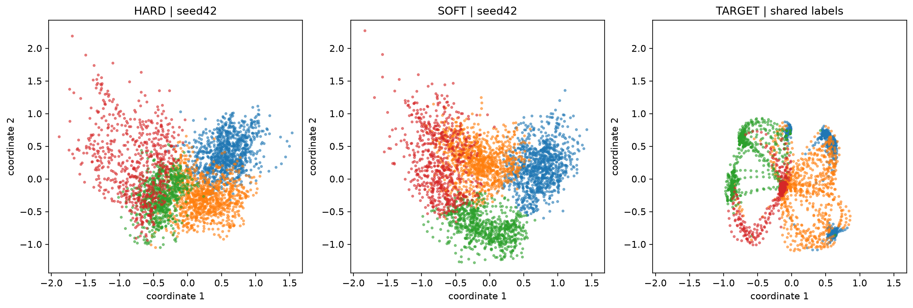
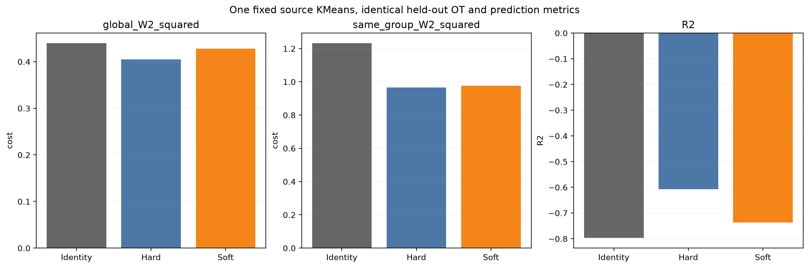
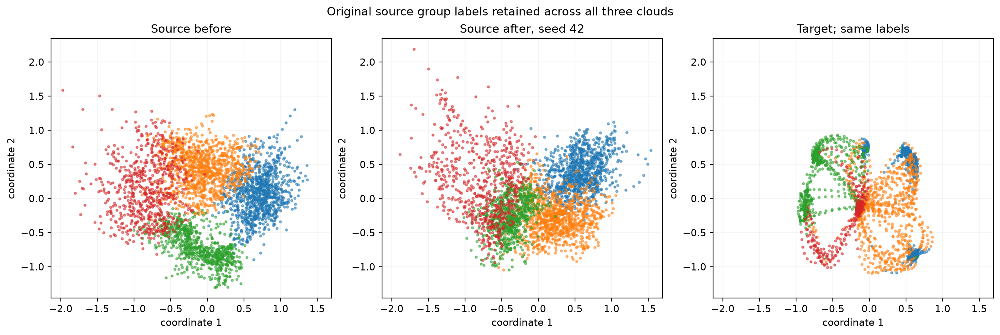

# DANDI 000138 × HiWA：唯一源域硬聚类四维对齐

**当前正式实验：只在源域 K-means 聚类一次，目标域按同步对应继承源域标签。对齐前、目标域、对齐后的源域使用从始至终相同的组。**

- [最新正式 XeLaTeX PDF（outer≤500，五次数值审计通过）](四维HiWA统一源域分组实验.pdf)
- [实验日志（按最新研究排列）](EXPERIMENT_LOG.md)
- [500 次扩展的最终数值、R、P、全部图片](results/source_only_fixed_groups_outer500/)
- [源域唯一 K-means 标签、原始两域图片及 140 次初始对齐（保留供复核）](results/source_only_fixed_groups/)
- [源域唯一聚类及绘图程序](code/source_only_fixed_group_pipeline.py)
- [原版 HiWA 运行器](code/run_hard_hiwa.py) · [原版算法源码](code/hiwa_original.py)
- [全维度评价、标签一致性校验及出图](code/evaluate_fixed_group_alignment.py)

## 实验协议（冻结）

1. 使用 DANDI:000138、MC_Maze_Large、v0.220113.0407 的已验证 NWB 派生数据。162 个神经放电通道→20ms 计数→平方根与平滑→训练统计标准化→PCA(4)。目标域是 (hand_pos_x,hand_pos_y,hand_vel_x,hand_vel_y) 原生四维，**不降维**。
2. 500 个有效试次按 trial 独立划分为 400 训练/100 测试，对应 14000/3500 个窗口。只在神经域训练点云上 **KMeans(K=4, seed=42,n_init=20)**；四个训练簇分别为 (4137,4316,3146,2401)。
3. 目标域每一个点的标签直接采用同一时间窗对应神经点的标签。测试神经点用训练源聚类器 predict，然后沿一一对应索引赋给测试目标。**不对目标域独立聚类，不在最优传输后再次聚类；颜色在全部可视化中不变。**
4. 在保持上述组不动的前提下，原版 HiWA 对源域学习全局正交矩阵，目标域不旋转。仅输入源/目标相同的组编号，不直接以配对回归误差训练 HiWA。原版 HiWA 内每个域/簇独立采样 40 点。
5. 固定 seeds 42–46，最终将最大外循环数从最初 140 扩至 **500**，其余原超参不变：mu=.05、局部 Sinkhorn gamma=.1、组间 Sinkhorn gamma=.2、局部最多 20 次。5/5 seed 通过 global-change≤.01、local-global residual≤.01、正交性和 OT 边缘审计（不是全局最优证明）。

**重要方法学限制：** 虽然 HiWA 仍利用分组上的非配对 OT 计算变换，但目标域组标签来自真实同步配对，因此这是**带有已知对应信息的组定义协议**，不是完全无监督的跨域聚类发现。1NN 也是用继承标签计算的固定组邻域一致性，不应冒充独立运动类别准确率。

## 最新补充：最优传输的留出测试误差（2026-11-17）

**HiWA 不能只用旋转后的配对欧氏距离评价。** 已对同一次唯一源 KMeans、目标继承标签、HiWA 500 次实验的冻结全局 R / 簇间 P 进行独立 OT 评价：

| 指标（归一化四维平方距离，越小越好） | 未对齐 | HiWA 后 5 seeds 均值 ± 样本标准差 | 代价降低 |
|---|---:|---:|---:|
| 无约束全域 OT W₂²，200×200 测试点 | 0.43948 | **0.40482 ± 0.04367** | **7.89%** |
| 同编号固定组内部 OT W₂²（经验质量），每组 128×128 | 1.23175 | **0.96642 ± 0.29007** | **21.54%** |
| 已学习簇间 P 加权组间 OT 代价（P 在比较前后固定） | 1.20303 | **0.95542 ± 0.03338** | **20.58%** |

[全部公式、随机采样协议、5 seeds 明细与图表](results/source_only_fixed_groups_outer500/ot_evaluation/OT_EVALUATION.md) · [原始结果 JSON](results/source_only_fixed_groups_outer500/ot_evaluation/OT_HELDOUT_METRICS.json) · [可复现评估代码](code/evaluate_hierarchical_ot.py)

**研究上必须区分：**第 2 项强制同编号组匹配，是最贴近「从始至终同一组」的评价协议；第 3 项保留原版 HiWA 所学的非对角 P，仍允许跨编号组传输。后者是利用保存的 global R 和 P 在留出测试集重新算的代理 OT 代价，**不是**原始算法含局部旋转与熵正则的完整训练目标，因为原始局部 R_ij 和 Q_ij 未保存。已学 P 的对角总质量均值约 0.3456，因此「固定聚类标签」并不意味着「算法已限制只能同组传输」。OT 分布误差改善不能直接证明同步运动预测 R² 成功，两者回答不同问题。

---

## 最新进展：Soft-GCOT vs Hard HiWA（五种初始化）

复用相同 DANDI 000138 四维特征、trial 划分、唯一源域 K-means 四个中心、目标继承标签与同一留出测试样本。**Soft 使用固定源原型的距离 softmax（τ=0.40）生成连续隶属度，目标按配对索引继承；不对目标单独聚类，不改变原硬标签的 argmax 身份。** 使用上传压缩包原版 GCOT 分层 OT 求解器，保持对齐的全局正交输出，五种种子，outer=500、inner=20、sample Sinkhorn=45、40/组采样。Soft 与 Hard 的实现及每组有效支持不同，因而是方法级对照，不能将差异完全归因于软化本身。

| 归一化测试指标 | 未对齐 | Hard（均值 ± SD） | Soft（均值 ± SD） |
|---|---:|---:|---:|
| 全域自由 OT W₂² ↓ | 0.43948 | **0.40482 ± 0.04367** | 0.42786 ± 0.03653 |
| **同编号固定组 OT W₂² ↓** | 1.23175 | **0.96642 ± 0.29007** | 0.97591 ± 0.21394 |
| MAE ↓ | 0.53149 | **0.49767 ± 0.05548** | 0.52215 ± 0.02929 |
| R² ↑ | -0.79649 | **-0.60738 ± 0.30314** | -0.73686 ± 0.16337 |
| 共享标签 1NN ↑ | 23.14% | **37.74% ± 21.62%** | 34.57% ± 17.19% |

**阶段性判断：** Soft 对未对齐基线也能降低固定同组 OT（1.23175→0.97591，约 20.8%），但没有超越 Hard 平均值（0.96642）。这不意味着软分组一般无效；仅有五个随机种子，结论受当前温度、优化器、数据表示及结构假设限制。全部五个 Soft seed 通过预设数值审计，结果如实保留。

[完整六投影三域散点图](results/soft_fixedgroup_vs_hard/hard_soft_target_six_pairs.png) · [详细对照报告](results/soft_fixedgroup_vs_hard/SOFT_HARD_COMPARISON.md) · [原始逐种子 R/P/指标 JSON](results/soft_fixedgroup_vs_hard/SOFT_HARD_COMPARISON.json) · [Soft-GCOT 运行器](code/run_soft_fixedgroup.py) · [上传压缩包原始 GCOT 源码快照](code/zip_gcot/)

**方法学限定：**目标软隶属度基于已知同步配对索引继承，因此不是 TPAMI 原版中两域分别学习原型的无监督 Soft-GCOT；不能将本对照视为原论文 Soft-GCOT 性能的直接复现。

---

## 当前正式结果：500 次以内运行的五个种子

相同测试集、相同归一化、相同四维表示：

| 评价 | 对齐前 Identity | Hard HiWA 五次均值 ± 样本 SD |
|---|---:|---:|
| 固定组标签的 1NN ↑ | 23.14% | **37.74% ± 21.62%** |
| 平均绝对误差 MAE ↓ | 0.53149 | **0.49767 ± 0.05548** |
| 配对相对平方误差 ↓ | 1.79266 | **1.60396 ± 0.30249** |
| 旋转 rMSE 代理 ↓ | 1.96470 | **1.49268 ± 0.78664** |
| 标准测试 R² ↑ | -0.79649 | **-0.60738 ± 0.30314** |

各种子 test R² 分别是 -0.75816、-0.56025、-0.10161、-0.86298、-0.75392（seed 42–46）。**尽管平均改善且都通过数值审计，测试 R² 仍全为负，跨初始化变化很大**。最佳 seed 44 不能单独代表整个算法。

rMSE 代理并非真实旋转恢复误差，因为此真实神经运动数据集没有旋转真值 Rgt；用训练集同步对应拟合的正交 Procrustes 作为参考。配对相对平方误差则是 SSE / sum(||target||²)，二者公式不同，均不取平方根。R² 使用标准 1−SSE/SST，独立评价器纠正了原版内部不标准的 _eval_R2 公式，原版算法代码没有修改。

## 源域 → 对齐后源域 → 目标域：相同标签的图

[查看四维的全部六组二维投影（三列直接比较）](results/source_only_fixed_groups_outer500/before_after_target_six_pairs.png) · [对齐前源](results/source_only_fixed_groups_outer500/source_before_test_six.png) · [对齐后源](results/source_only_fixed_groups_outer500/source_after_test_six.png) · [目标域](results/source_only_fixed_groups_outer500/target_shared_test_six.png)

所有图均显示相同的 3500 个留出测试时窗；主图固定画 seed 42，不按测试结果择优选择画图种子。目标点颜色来自其配对源点的 K-means 标签。二维仅为可视化，K-means 与 HiWA 均在四维完成。

## 代码来源与复现

算法：用户上传 GCOT-reproducible-20261018.zip 中的 reference/HiWA/PyHiWA/src/hiwa.py 原版，项目目录里的 code/hiwa_original.py 的 SHA256 为 4419e19004b06c7840d187ddb12a19b2ad97974dd28ad1dc9510d8ead741da6a；其他旧版 src/hiwa 代码不参与本轮实验。

重现时先复用冻结的四维观测缓存，只重新分组、重新训练 HiWA：

- Python：安装 numpy、scipy、scikit-learn、matplotlib。
- 只聚类：python code/source_only_fixed_group_pipeline.py --input results/clustering/clustered_4d.npz --output results/source_only_fixed_groups --seed 42 --k 4
- 原版 HiWA：python code/run_hard_hiwa.py --clusters results/source_only_fixed_groups/fixed_groups_4d.npz --output results/source_only_fixed_groups_outer500 --seeds 42 43 44 45 46 --outer 500
- 评价与图：python code/evaluate_fixed_group_alignment.py --input results/source_only_fixed_groups/fixed_groups_4d.npz --alignment results/source_only_fixed_groups_outer500/hard_hiwa_results.json --output results/source_only_fixed_groups_outer500
- 生成论文数值：python code/write_converged_summary.py

上述命令相对于当前项目文件夹执行。GitHub Actions 的实际成功运行与全部计算工件保存在仓库历史及工作流运行记录中。

## 历史实验（不再作为当前协议）

- [旧实验：两域分别 K-means、140 次外循环](results/hard_hiwa/)——已废弃的分组设定，仅保留供方法论对比。
- [新单次源聚类，但仅 140 次外循环](results/source_only_fixed_groups/)——三种子未满足额外残差审计，现已由 500 次实验替代。
- [旧版技术诊断 PDF](四维HardHiWA实验与问题诊断.pdf)——仍描述原来的两个域独立分组实验，属于历史文档；现行报告是本 README 开头所链接的统一分组 PDF。
