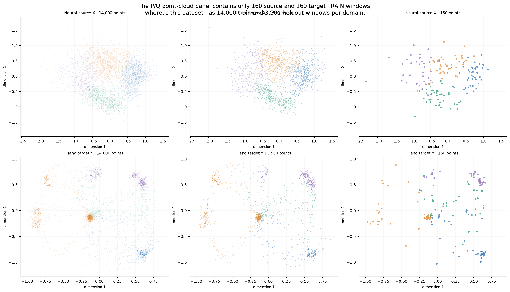
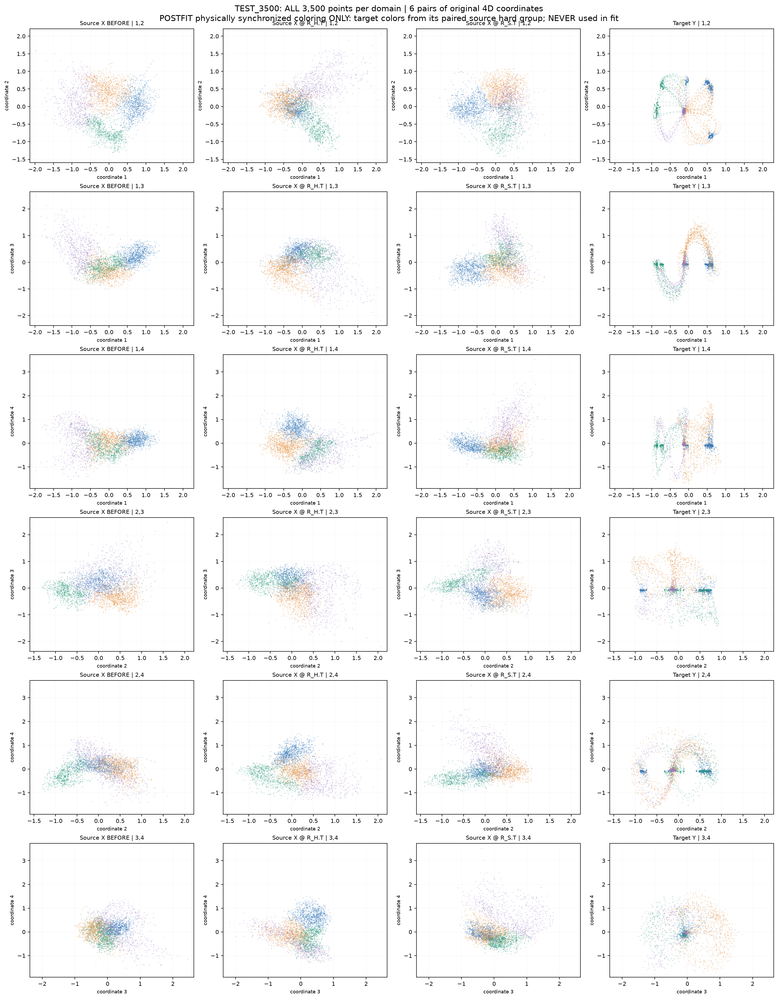
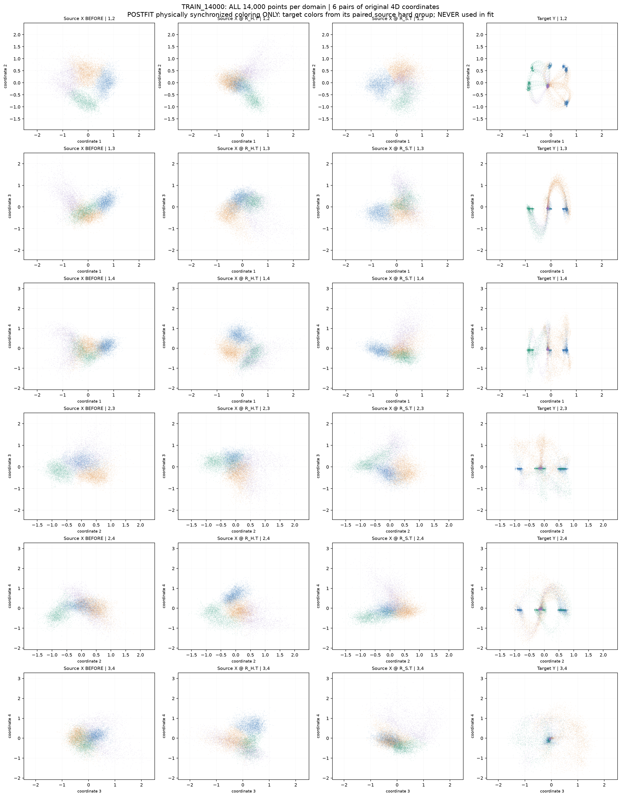
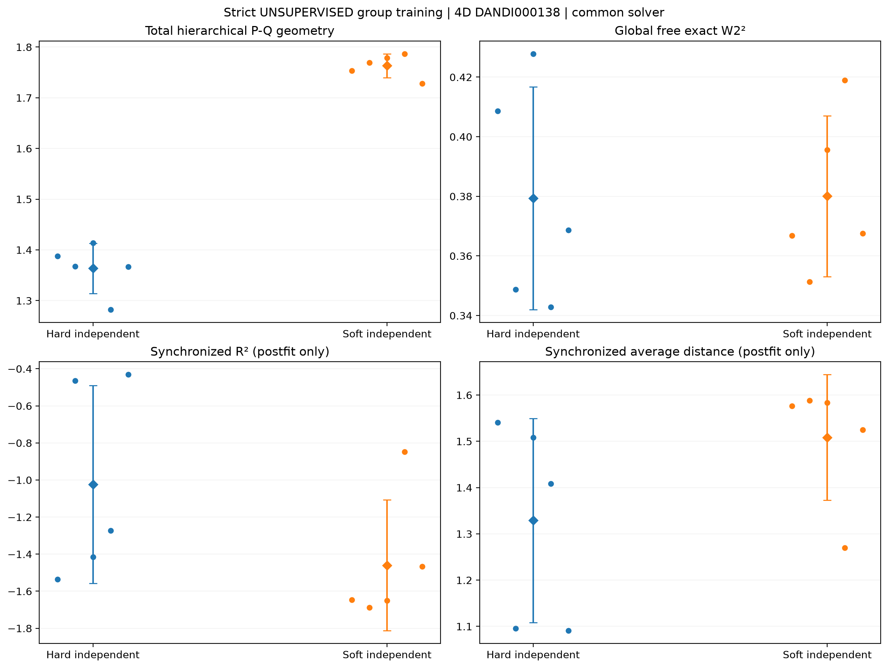
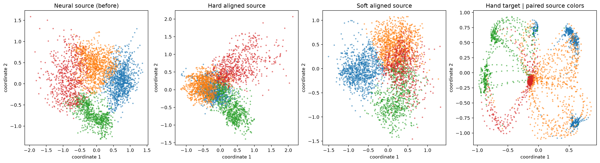
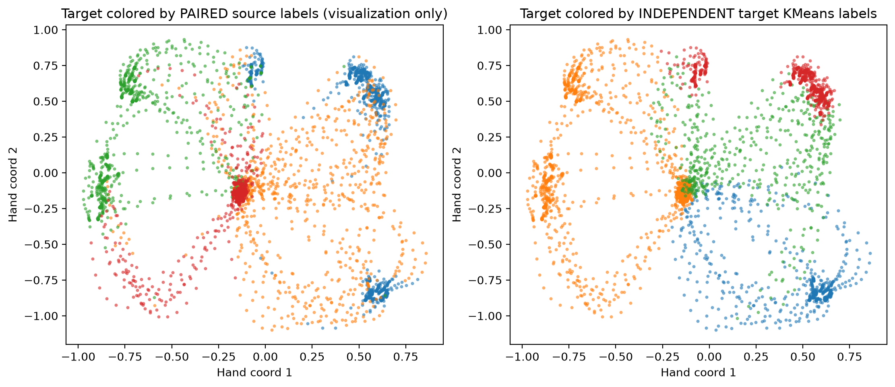

# DANDI 000138 · 四维 HiWA / Soft-GCOT 严格无监督实验

**现行有效版本（2026-11-18）：源域与目标域分别独立分组；真实同步样本对应只在训练完成后用于评价和着色。**

> [!CAUTION]
> 2026-11-17 曾将源域可视化标签复制给目标域参与训练，因此之前的源域唯一分组、固定 Soft、边界自适应 Soft 等结果仅属于**组级监督诊断**，不是正式无监督实验。原资料保留在 [历史 README](HISTORICAL_GROUP_SUPERVISED_README.md) 与 [专项审计](GROUP_LABEL_LEAKAGE_AUDIT.md)。

## 全量数据点云图库（2026-11-18）

**原始数据不缺点：500 trials×35 windows=17,500个时间窗/域；400个训练试次含14,000点，100个独立测试试次含3,500点；单个GCOT求解过程只是每个域按四个独立Hard K-means簇抽40点，共160点。**旧传输计划图只出现160个点是该次求解器抽样数量，不代表整个实验数据只有160点。

本次仅从已冻结独立分组4D数据和已训练Hard/Soft seed42的R重绘，**没有重新训练模型**。神经162通道以运动开始时刻为中心取−100至+600ms、20ms窗口，sqrt放电率、40ms高斯时间平滑、训练集zscore、训练集PCA(4)；目标使用hand position x/y和velocity x/y各自训练集zscore。PCA四维累计解释标准化神经方差 **13.06%**；没有额外做PCA白化，进GCOT前两域分别按训练RMS半径归一化。

**完整图像与数据审计：** [7张全量散点图图库](results/full_scatter_gallery/FULL_SCATTER_GALLERY.md) · [两域独立训练Hard分组（14000点）](results/full_scatter_gallery/TRAIN_14000_all_4D_projections_independent_HARD_Kmeans.png) · [两域独立测试Hard分组（3500点）](results/full_scatter_gallery/TEST_3500_all_4D_projections_independent_HARD_Kmeans.png) · [两域独立Soft原型分组（3500点）](results/full_scatter_gallery/TEST_3500_all_4D_projections_independent_SOFT_prototype.png) · [17500全部时间窗（6投影）](results/full_scatter_gallery/ALL_17500_all_4D_projections_independent_HARD_Kmeans.png) · [逐行原始索引/样本计数/处理参数](results/full_scatter_gallery/FULL_SCATTER_DATA_AUDIT.json)

---
## 数据、方法与严格隔离

- **数据保持不变：**DANDI:000138、4D 神经 PCA / 4D 手部位置速度、500 trials × 35 = 17,500 窗口、原400/100个试次独立划分（14,000训练、3,500测试）。每域按原实验训练集统计作 RMS 归一化；未另行抽取250对样本。
- **原版 PyHiWA Hard：**原始 [hiwa_original.py](code/hiwa_original.py) 数值求解器，X、Y分别独立 K-means，5 seeds，最多500外循环。
- **同核 GCOT Hard：**X、Y各自独立 K-means 硬组，在同一 [ZIP-GCOT hierarchical_alignment](code/zip_gcot/alignment.py) 中使用 one-hot 组权重。
- **同核 GCOT Soft：**使用原始 [soft_groups](code/zip_gcot/grouping.py) 分别从 X_train、Y_train 独立学习 A、B，绝不从源域同步复制 B；没有固定已知组排列。
- **组级传输 P：**均匀初始化后由组级 Sinkhorn 自由优化；没有 P=I₄/4 的对角真值约束。两种同核模型使用完全相同的每种子训练点池、随机初始化与主数值配置：K=4、40点/组、outer≤500、inner≤20、局部 Sinkhorn 45、组间 Sinkhorn 200、μ=.05、εsample=.1、εgroup=.2、scale=True。
- **信息隔离：**同步索引不得进入聚类、原型学习、R/P/Q求解、初始化或选参；统一散点颜色、配对 MAE/R² 等仅在拟合结束以后计算。全域OT 200+200留出点独立采样。

## 五种随机种子的真正无监督结果

下表为均值 ± 初始化样本标准差。三组使用相同留出样本、坐标尺度和评价公式；只有**同核 GCOT Hard vs Soft**是纯分组机制的同求解器对照。原版 PyHiWA 的数值实现独立，作为历史原版参考。

| 测试指标 | 变换前 | 原版 PyHiWA 独立 Hard | 同核 GCOT 独立 Hard | 同核 GCOT 独立 Soft |
|---|---:|---:|---:|---:|
| **全域自由 OT W₂² ↓** | 0.43948 | 0.40033 ± 0.02187 | **0.37935 ± 0.03739** | 0.38006 ± 0.02701 |
| 同步相对平方误差 ↓ | **1.79266** | 1.89068 ± 0.22460 | 2.01966 ± 0.53277 | 2.45456 ± 0.35169 |
| 同步平均欧氏距离 ↓ | **1.25671** | 1.29230 ± 0.10076 | 1.32886 ± 0.22030 | 1.50859 ± 0.13560 |
| 同步 MAE ↓ | **0.53149** | 0.55162 ± 0.05091 | 0.56308 ± 0.10787 | 0.63677 ± 0.05338 |
| 同步标准 R² ↑ | **-0.79649** | -0.89472 ± 0.22508 | -1.02398 ± 0.53391 | -1.45981 ± 0.35244 |

**关键科学发现：**三种无监督方法都降低全域分布 OT 代价，但没有改善同步神经—运动预测；所有方法的同步 R² 都比变换前的 -0.79649 更低。不能把分布对齐直接解释为准确运动重建。

### 同一个 GCOT 求解器：完整分层 P-Q OT 几何代价

| 留出测试指标（P为拟合所得，重新求解测试Q，不含熵项） | 独立 Hard | 独立 Soft |
|---|---:|---:|
| 变换前完整分层总 OT | 1.85664 ± 0.14978 | 1.85147 ± 0.01055 |
| **变换后完整分层总 OT ↓** | **1.36360 ± 0.04949** | 1.76326 ± 0.02332 |
| 训练 P-Q 几何代价 | **1.33988 ± 0.07432** | 1.86588 ± 0.06379 |
| 训练原始含熵目标 | -11.91720 ± 0.01559 | -15.16207 ± 0.05434 |

**比较限制：**软、硬组条件概率测度不同，分层P-Q几何代价不代表同一固定测度上的严格Wasserstein排名；不同样本支持对应的原始负熵目标也不能仅按越负越好判优。共同固定边际的全域自由OT几乎相同。

### 数值收敛审计

原版 PyHiWA 独立 Hard 在其原始全局旋转变化、局部共识及边缘检查中为 **5/5 通过**；同核 GCOT 独立 Hard 在严格 ADMM 判据中 **5/5 通过**；同核 GCOT 独立 Soft 在严格 ADMM 判据中 **0/5 通过**，全部达到500次外循环上限，尽管宽松历史残差检查为5/5。Q/P边缘误差均通过。**仅停止或迭代耗尽绝不等于已收敛**。因此当前只代表相同计算预算下的结果，不能据此判断Soft可达到的全局最佳水平。

## 原始证据和复现

- [同核 Hard/Soft 详细报告和全部残差](results/strict_unsupervised_hard_soft/STRICT_UNSUPERVISED_REPORT.md)
- [原版 PyHiWA、同核 Hard/Soft 三组相同测试指标报告](results/strict_unsupervised_hard_soft/THREE_WAY_POSTFIT.md)
- [五种种子 R/P、分层P-Q OT与所有误差的 JSON](results/strict_unsupervised_hard_soft/STRICT_UNSUPERVISED_RESULTS.json)
- [原版独立聚类 PyHiWA 的 500 外循环原始结果](results/strict_unsupervised_original_hiwa500/hard_hiwa_results.json)
- [严格无监督 Hard/Soft 可重现程序](code/run_strict_unsupervised_hard_soft.py)
- [原版 PyHiWA 训练入口](code/run_hard_hiwa.py) · [统一训练后误差计算程序](code/compare_postfit_original_hiwa_gcot.py)
- [原有双域独立分组 NPZ](results/clustering/clustered_4d.npz) · [四维全部六投影](results/strict_unsupervised_hard_soft/unsupervised_hard_soft_target_six_views.png)
- [研究日志](EXPERIMENT_LOG.md) · [泄漏代码审计](GROUP_LABEL_LEAKAGE_AUDIT.md) · [历史组级监督资料](HISTORICAL_GROUP_SUPERVISED_README.md)

保留过去 source_only_fixed_groups、source_only_fixed_groups_outer500、soft_fixedgroup_vs_hard、controlled_hard_vs_soft_PQ 和 boundary_adaptive_trial_cv 目录，以供组级监督诊断复核；**不得混入本次正式无监督基线**。
