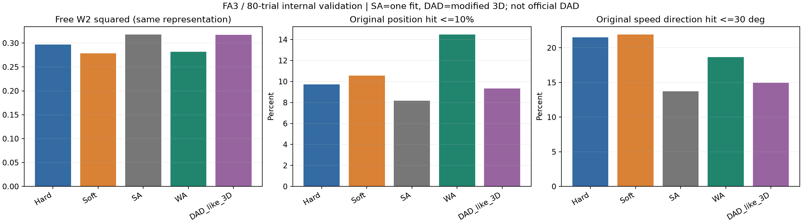
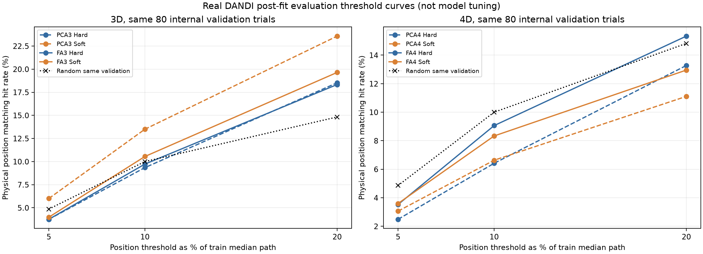
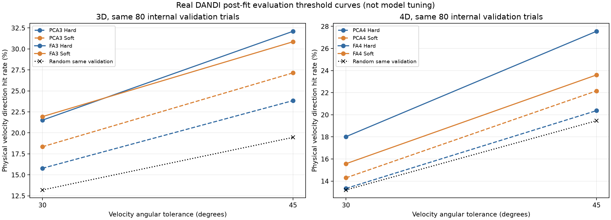
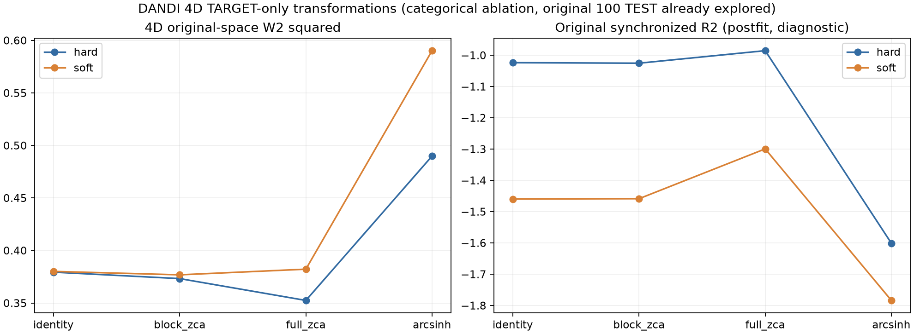
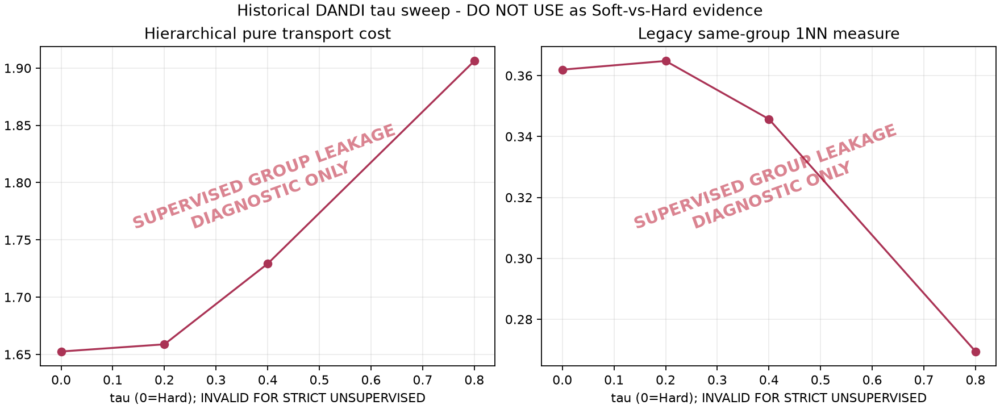

# DANDI:000138 · HiWA / Soft-GCOT 无配对层级最优传输实验收尾报告

**归档日期：2026-11-19｜项目状态：本数据实验停止扩大调参，保留为边界案例｜研究对象：DANDI:000138 / MC_Maze_Large，而非 Hyser。**

> **结论**：对真实神经—手部运动点云，双层 HiWA/GCOT 能降低一些无配对分布运输距离，但目前**没有**可靠证据证明所学关系恢复了真实神经—运动对应，也**没有**证据证明 Soft-GCOT 在稳定、合格求解的前提下系统优于 Hard-HiWA。FA3 的物理方向检索比四维好一些，但仍不足以得出方法优越性结论。**不应把漂亮的 Fisher 图、运输矩阵块结构或低 W₂² 当作真实匹配成立的证明。**

## 一、最初研究问题与真正解决的问题

原始问题：当跨模态的分组并不清楚时，让每个源/目标样本属于多个概率组（Soft-GCOT），能否相对 Hard-HiWA 的 one-hot 分组提升 **P（组级）—Q（组内）两层最优传输**的对齐质量、数值稳定性，以及对应的现实运动学匹配？

最终得到的是 **可否使用该数据回答原问题的有效性判断**，而不是“Soft 胜过 Hard”的正结果：

1. **数据与算法能够真实运行**：官方 NWB 162 神经单元，500 trials ×35 个 20ms 时间窗 = 17,500 点/域；神经 PCA/FA 和手部运动预处理、独立硬/软分组、局部 \(R_{k\ell}\)、簇级 \(P\) 和样本级 \(Q^{k\ell}\) 均已实现和审计。
2. **原始四维数据物理含义明确**：目标 \((p_x,p_y,v_x,v_y)\)。神经活动是 PCA/FA 潜在变量，源/目标欧氏几何并不会天然同构。验证集中真实同步样本的域内两两距离 Pearson 相关仅约 **0.0602**（原目标四维设置），提示原表示缺少强的**刚性共同几何**；它不排除更复杂的非线性、时滞关系。
3. **分布匹配与真实对应可能脱钩**：经典四维严格无配对对照，同求解器 Hard/Soft 的整体 \(W_2^2\) 约 **0.37935 / 0.38006**（独立原测试 100 trials 已被历史探索观察）。其真实同步标准 \(R^2\) 约 **−1.024 / −1.460**，都没有胜过恒等基准约 **−0.796**。这说明降低边缘运输成本不等于恢复真实配对。
4. **最初的 Soft 数值约束没有通过**：经典四维同核 Hard 严格 ADMM 审计 5/5，Soft 0/5；内部分割 PCA4/FA4 Soft 也均 0/3。不能把一个未通过同等收敛准则的 Soft 输出作为充分优化后的软分组性能。
5. **三维具有实验价值但不是物理恢复**：训练内 PCA3 将标准化手部四维的 **83.61% 方差**保留为三个**混合坐标**，主要损失水平位置/水平速度的部分信息；FA3/运动 PCA3 的位置、方向检索在本次相同内部验证上总体优于 FA4/原始手部四维，但维度之间的潜空间 OT 绝对数值不可直接比较。
6. **求解器正向控制与真实数据出现分歧**：合成数据的失败与修复提示初始化/可辨识性是独立问题；更稳定的合成正向控制并没有直接转化为 DANDI 上有意义的真实物理对应。合成旋转误差从未成为本项目最终应用目标。

## 二、整个研究路线与每一步实际做过什么

| 阶段 | 实际操作 / 目的 | 发现、状态与关键档案 |
|---|---|---|
| ① 原始数据核验 | 官方 NWB 版本、SHA、hand 与 cursor 区分；确定神经元、运动四分量、事件中心、时间窗与 trial 独立切分 | [原始处理](../code/run_hard_clustering.py)、[原始四维聚类](../results/clustering/clustering_report.json) |
| ② 先看数据，再定义模型 | 全部17,500窗口统计、原始点云多视角、源/目标各自四簇结构、行为标签后验语义、跨域距离关系检查 | [全点图](../results/full_scatter_gallery/FULL_SCATTER_GALLERY.md)、[簇语义审计](../results/phase1_preflight/PREFLIGHT_REPORT.md)、[目标域几何](../results/target_only_geometry_full/TARGET_TRANSFORM_REPORT.md) |
| ③ 初始 HiWA | 从每簇各40点独立抽样；原作者风格 Hard 及 P/Q/R/ADMM、残差检查 | [原版与三方比较](../results/strict_unsupervised_hard_soft/THREE_WAY_POSTFIT.md) |
| ④ 修复真实无监督协议 | 发现“把源域同步标签复制给目标训练分组”的**组级监督泄漏**；重新独立分组，P 自由学习；旧实验永久标历史诊断 | [泄漏审计](../GROUP_LABEL_LEAKAGE_AUDIT.md)、[合格同核 Hard/Soft](../results/strict_unsupervised_hard_soft/STRICT_UNSUPERVISED_REPORT.md) |
| ⑤ 数值及理论审计 | MATLAB 公式对照、局部Q/全局R/共识与熵项、合成已知对齐正向对照、谱暖启动 | [源码修复](../CODE_AUDIT_AND_FIX_2026-11-19.md)、[正向实验](../results/phase1_synthetic_control/SYNTHETIC_POSITIVE_CONTROL_REPORT.md) |
| ⑥ 四维数据表示消融 | 仅目标域 identity/block ZCA/full ZCA/arcsinh；多种物理/分布评价 | [目标转换](../results/target_only_geometry_full/TARGET_TRANSFORM_REPORT.md) |
| ⑦ 从原神经信号重做 PCA/FA | 从原162通道重新训练 PCA4/FA4；把原训练400 trials 分为 **320 内训 /80 内验**，原100测试试次不再用于这轮模型选择 | [4D内验报告](../results/PCA4_FA4_inner_validation/DANDI_PCA4_FA4_REPORT_ZH.md) |
| ⑧ 比较 3D 与 4D | 神经 PCA3/FA3；目标由训练四维运动 PCA3；相同 320/80 split、seed42–44、独立分组、真正的原始四维物理匹配评分 | [3D/4D对照](../results/PCA3_FA3_vs_PCA4_FA4_inner_validation/DANDI_3D_VS_4D_REPORT_ZH.md) |
| ⑨ Fisher 和散点图审计 | Fisher2/3 严格仅由**训练组伪标签**拟合；对齐点投到目标 Fisher 基；修正最右列只显示蓝橙两域颜色的问题：保留四簇源色+灰色目标背景 | [四色图档](../results/real3d4d_fisher_gallery_fourgroups/PHYSICAL_SEMANTICS_AND_FISHER_REPORT.md) |
| ⑩ 收尾基线 | **真实运行**独立 SA、WA，以及明确标注为改编而非官方的 DAD-like（只在 FA3）；相同 320/80 split、真实四维物理指标 | [实际逐种子结果](../results/closeout_baselines_real_DANDI/DANDI_SA_WA_DAD_ADAPTED_RESULTS.json)、本归档的比较表与图 |
| ⑪ 研究决策 | 检查可解释性、训练完整性、真实匹配、与基线差异，确定停止在此数据上继续寻找“漂亮对齐” | 本文件及[下一次实验流程](NEXT_EXPERIMENT_WORKFLOW_ZH.md) |

**注意实验计数**：17,500是全量时间窗；14,000/3,500是原400/100试次；11,200/2,800是内部320/80试次。**160/域是每次两层 OT 求解所抽的训练样本数**，不是完整数据只有160点。不同层级的数不能混写。

## 三、内部分割的统一 3D/4D 结果

所有方法 \(K=4\)、随机种子42–44、每簇各40点、同核 P/Q/R 与训练成本预算。**这是仅一次内部 trial 分割上的三个初始化，不是三名独立被试。** 位置命中阈值：内训典型单次手部行程的10%（约18.4567原始记录单位）；速度方向容差30°，低速阈值由训练速度20%分位确定。最近邻目标排除同一 trial；匹配的物理误差始终在**未降维的四维原始手部运动坐标**上计算。

| 潜空间 | 方法 | 内验无配对 \(W_2^2\)↓ | 内验嵌套 P/Q 运输↓ | 实际位置≤10%↑ | 实际方向≤30°↑ | 严格ADMM |
|---|---|---:|---:|---:|---:|---:|
| PCA3/手部PCA3 | Hard | 0.3611 | 1.1675 | 9.35% | 15.78% | 3/3 |
| PCA3/手部PCA3 | Soft | 0.3312 | 1.4482 | **13.50%** | 18.35% | 2/3 |
| FA3/手部PCA3 | Hard | 0.2969 | 1.0545 | 9.73% | 21.52% | 3/3 |
| FA3/手部PCA3 | Soft | 0.2783 | 1.4449 | 10.55% | **21.94%** | 3/3 |
| PCA4/原目标4D | Hard | 0.4156 | 1.3491 | 6.42% | 13.33% | 3/3 |
| PCA4/原目标4D | Soft | 0.3774 | 1.7618 | 6.63% | 14.29% | 0/3 |
| FA4/原目标4D | Hard | 0.3603 | 1.3427 | 9.06% | 18.02% | 3/3 |
| FA4/原目标4D | Soft | 0.4078 | 1.7711 | 8.33% | 15.57% | 0/3 |
| 同内部验证随机匹配 | — | — | — | **10.00%** | **13.20%** | — |

**正确解释**：3D/4D 的原生 \(W_2^2\) 和 P/Q 运输成本来自**不同维度、不同概率测度**，不可因 3D 数字更小就宣布降维成功；Hard/Soft 的原生条件组质量和熵也不同，原生 P/Q 数值不可直接作为绝对公平排名。能够直接横向比较的是同一原始物理量、同一阈值、同一试次上的位置/速度匹配误差；这部分虽然 3D 较好，但绝对效果仍弱。

## 四、额外真实 DANDI 基线：SA / WA / DAD 等

所有新增基线使用与 FA3/FA4 同一内部验证试次与原始手部物理评分规则，训练只取每次真实 Hard 归档的各域 **160 个无配对训练点**，没有使用原测试100 trials。**这些基线没有层级 P/Q**，只能与 HiWA 比较同口径自由 \(W_2^2\)、位置/方向检索，**不能伪造基线层级运输代价**。

| 表示 | 方法 | 次数 | 自由 \(W_2^2\)↓ | 位置≤10%↑ | 方向≤30°↑ | 复现级别 |
|---|---|---:|---:|---:|---:|---|
| FA3 | Hard-HiWA | 3 | 0.2969 | 9.73% | 21.52% | 同核完整P/Q/R |
| FA3 | Soft-GCOT | 3 | **0.2783** | 10.55% | **21.94%** | 同核完整P/Q/R |
| FA3 | SA | 1 | 0.3181 | 8.18% | 13.74% | 作者代码公式的 full-basis 转写，确定性 |
| FA3 | WA | 3 | 0.2821 | **14.49%** | 18.68% | 作者式退火 Sinkhorn/正交对齐转写 |
| FA3 | DAD-like | 3 | 0.3170 | 9.35% | 14.94% | **改编的三维密度KL网格搜索；绝非官方 MATLAB DAD** |
| FA4 | Hard-HiWA | 3 | 0.3603 | 9.06% | 18.02% | 同核完整P/Q/R |
| FA4 | Soft-GCOT | 3 | 0.4078 | 8.33% | 15.57% | 同核完整P/Q/R（严格ADMM 0/3） |
| FA4 | SA | 1 | 0.4748 | 6.14% | **21.04%** | 作者代码公式的 full-basis 转写 |
| FA4 | WA | 3 | **0.3384** | 7.79% | 15.03% | 作者式退火转写 |

**不能挑有利的排名**：FA3 的 WA 平均位置14.49%高于 Hard/Soft，但三次分别只有约2.14%、21.18%、20.14%，初值波动极大；SA 为单次确定性结果；DAD 是自行改编，不能写“战胜/不如原版DAD”。基线这轮是收尾补充性探索，而不是方法公平性已获理论证明。HiWA-SSC、HiWA-GMM、CORAL、ICP 等见[方法与参数清单](METHODS_AND_PARAMETERS_ZH.md)：**没有在此 DANDI 320/80 设置运行的不得填入成绩**。Hyser 的多模型结果绝不跨数据集搬用。

## 五、已有真实曲线 vs 没有开展的参数曲线

### 已测的曲线（可复核）

- **位置容差 5%/10%/20%**：同一原始手部位置距离、同一80试次，统计3D/4D Hard/Soft 与随机基线；阈值增加时每个方法都会变得“更准”，**不能通过把阈值调大声称算法提升**。
- **速度方向容差 30°/45°**：同一原始速度向量、相同训练低速过滤、方法/随机基线共同比较。
- **三维/四维表示消融**：表示选择是离散设计变量，潜变量运输成本只在相同表示内部有可比意义。
- **四维目标变换**：identity、block ZCA、full ZCA、arcsinh 为四种离散预定处理，在逆变换后的共同原始四维空间重算自由 OT；不能称为连续参数曲线。
- **旧历史 Soft 温度 τ=0、0.2、0.4、0.8 曲线**：确实运行过，但目标训练组标签通过**真实配对源标签继承**；这是**组级监督泄漏**，只能隔离在警告图中，绝对不能用于无配对 Soft 优势证据。

### 明确尚未运行、不可画成“实验结果”的曲线

**“簇重叠程度 \(\rho\) — Hard/Soft 真匹配率”曲线只有研究假设，没有 DANDI 的真实结果。** 若新项目允许使用已知组生成机制的数据，可将组重叠程度（例如类条件均值距离/簇内尺度比）、软温度 \(\tau\)、簇数 \(K\)、优化罚系数 \(\mu\) 作为**事先固定的控制变量**，分别作曲线：纵轴真实组质量匹配率/样本匹配率、共享层级 \(T,J\)、收敛通过率以及 Soft−Hard 成对差；按独立生成数据集与随机种子给出分布/置信区间。不能用本次并无真组标签的 DANDI 随意编出该曲线，不能使用模型输出产生的伪标签作为“正确率真值”。

## 六、经验教训：最值得带走的成功与失误

**成功：**（a）保留原始 NWB 版本及 SHA，完整数据和 160求解抽样区分；（b）发现并隔离了源簇信息经同步索引泄漏到目标训练的错误；（c）正确保留了后验共享颜色**只能用于作图**的例外，训练时目标必须自行分组；（d）发现普通自由 \(W_2^2\)、组级 \(P\)、条件 \(Q\)、完整熵目标 \(J\)、真实物理匹配分别回答不同问题；（e）核对源码、合成正向控制、数值残差及全种子失效，而非只汇报最好 seed；（f）通过 3D/4D 和原始四维物理评价发现视觉与物理之间的落差。

**失误与防再犯：**（a）开始前没有先证明数据存在合适的跨域几何联系或明确 OT 应恢复何种现实结构；（b）在测试集上反复试探（原100 trials 已不可再视作完全盲测）；（c）曾将匹配问题转成“预测”或几何恢复，偏离用户确定的 P/Q 传输与真实匹配目标；（d）将 Fisher 选择的可分性误当本来就有的清晰簇；（e）对齐覆盖图将四簇着色错误换成两种模态色，掩盖实际组结构；（f）原生不同条件测度/维度的 OT 绝对值不应硬比较；（g）把数值停止或边际可行误判为真实对应成功；（h）三维 PCA 损失的物理信息不是噪声的证据，不因图更好看就贸然删除。

**综合判断**：保留 DANDI 作为真实模态不匹配/可辨识性困难的边界案例，**停止继续尝试靠调参或选图证明软分组优势**。下一套主数据必须先经过[先验检查—真实对应门槛—公平基线—参数曲线的实验流程](NEXT_EXPERIMENT_WORKFLOW_ZH.md)。

## 七、数据和可复核证据

- 原始资料：DANDI:000138 v0.220113.0407，NWB `sub-Jenkins_ses-large_desc-train_behavior+ecephys.nwb`，大小148,590,536 bytes；SHA-256 `1188ddf5b822dd9ac49afb8916f4b42a85867613cf7f169d0b04a1d1aeecd700`。原始 NWB **不入 Git**，脚本按官方版本下载并校验。原手部位置/速度的物理单位未做完整原始元数据核实，本报告不会捏造为厘米或厘米/秒。
- 原500 trial/400-100划分的旧测试成绩是探索性历史对照；**更适合用于当前方法比较**的是完全不动原100测试的400内拆320/80，但同一80内部验证集已经用于研究选择，最终仍需全新独立验证。
- 所有源代码、真实 JSON/NPZ、独立图表、数值审计及工作流索引均在本 DANDI 项目目录，详见 [文件与来源索引](ARCHIVE_AND_PROVENANCE_INDEX_ZH.md)；不会对 `experiments/hyser/` 作任何改动。
- 重算图表的源输入文件、具体公式、单位以及每条实验的合格程度请同时查看 [方法与参数清单](METHODS_AND_PARAMETERS_ZH.md)、[曲线原始 CSV](tables/DANDI_3D4D_REAL_PHYSICAL_TOLERANCE_CURVES.csv)、[全部实测模型对照 CSV](tables/DANDI_SAME_VALIDATION_METHOD_COMPARISON.csv)。

**最后决定：DANDI 这轮实证研究到此收束；保留全部正面、负面以及曾有监督泄漏的历史信息，并为下一数据集设立先验适用性检查和客观停止门槛。**
