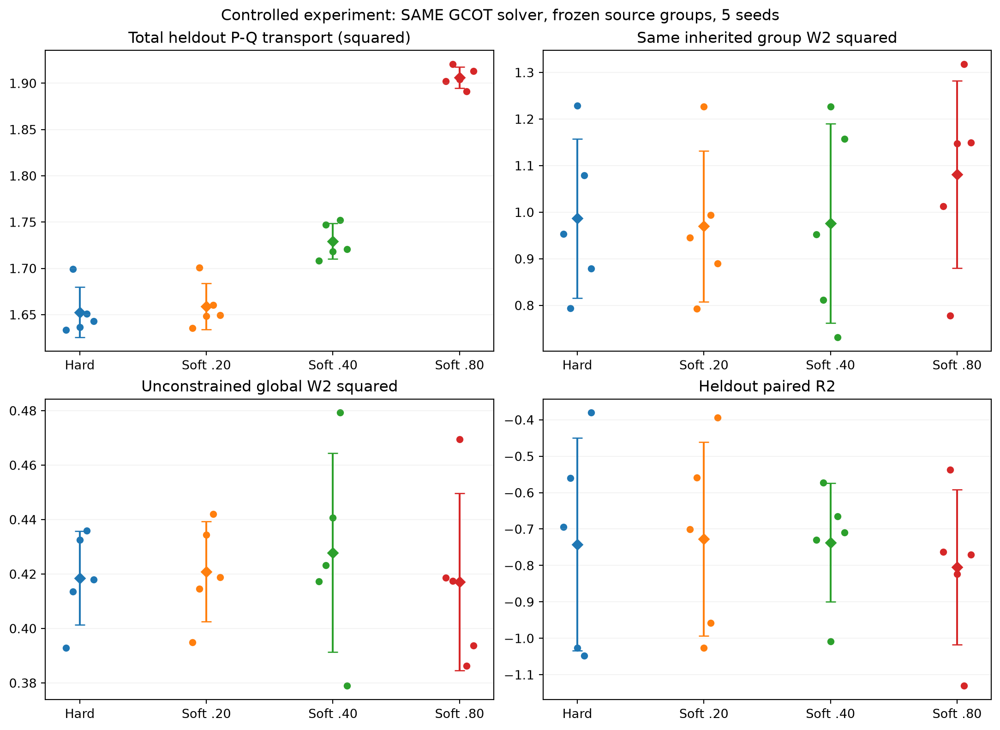
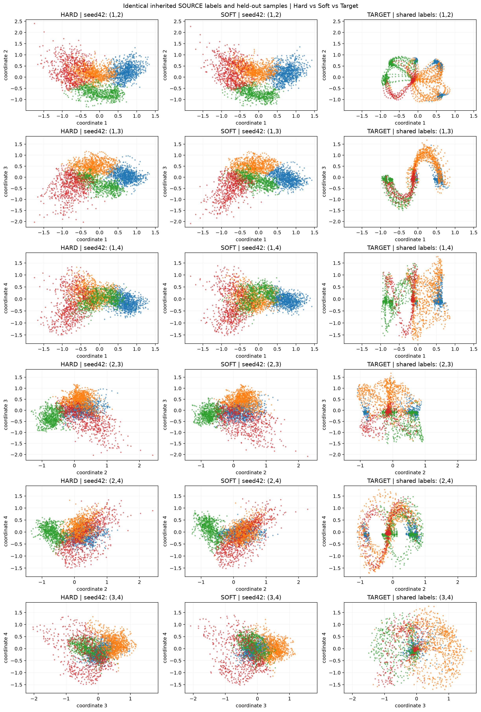

**实验类型：组级监督诊断（NOT UNSUPERVISED）**。目标训练标签或软隶属度从同步配对的源域标签传播，不能当作严格无监督 Hard HiWA / Soft-GCOT 基线；数值、图像及其他参数保留为历史诊断。见 [专项审计](https://github.com/noelabernathy400-bot/ot-hiwa/blob/main/projects/dandi-000138-hiwa-4d/GROUP_LABEL_LEAKAGE_AUDIT.md)。

# DANDI 000138: Same GCOT solver, source-only Hard/Soft controlled ablation

Same source KMeans prototypes and one family of labels across neural/hand data;
target inherits (hard or soft) membership from paired source window.
This protocol uses known pairwise information, not fully unpaired soft grouping.
Five common seeds, same sampled training points, same GCOT solver, equal numerical budgets.

## HELDOUT TOTAL hierarchical P-Q transport cost
The trained group plan P is frozen on test; local sample Q is reoptimized
using the original ZIP Sinkhorn with temperature epsilon_sample/Pij.
Primary cost is sum_ij Pij <Qij, 4D squared distance>; raw entropy
is excluded, because support-dependent negative entropy constants
would artificially favor larger (soft) support.

| Membership | Total P-Q OT before | Total P-Q OT after | Same-group W2sq | Global W2sq | R2 | MAE | 1NN | Audit |
|---|---:|---:|---:|---:|---:|---:|---:|:---:|
| hard | 1.84457 ± 0.11774 | 1.65257 ± 0.02705 | 0.98655 ± 0.17106 | 0.41854 ± 0.01722 | -0.74185 ± 0.29195 | 0.52131 ± 0.04890 | 0.36194 ± 0.12830 | 5/5 |
| tau0.20 | 1.83751 ± 0.10973 | 1.65883 ± 0.02489 | 0.96980 ± 0.16222 | 0.42092 ± 0.01838 | -0.72735 ± 0.26579 | 0.51901 ± 0.04516 | 0.36480 ± 0.13018 | 5/5 |
| tau0.40 | 1.85479 ± 0.06809 | 1.72925 ± 0.01924 | 0.97591 ± 0.21394 | 0.42786 ± 0.03653 | -0.73686 ± 0.16337 | 0.52215 ± 0.02929 | 0.34571 ± 0.17191 | 5/5 |
| tau0.80 | 1.93353 ± 0.00516 | 1.90621 ± 0.01131 | 1.08109 ± 0.20117 | 0.41710 ± 0.03261 | -0.80493 ± 0.21280 | 0.53363 ± 0.03634 | 0.26943 ± 0.15302 | 5/5 |

## Soft membership entropy (normalized by log(4))
- hard: -0.000000
- tau0.20: 0.048600
- tau0.40: 0.267728
- tau0.80: 0.840287

## Full per-seed data
- hard, seed=42: total P-Q OT=1.63331, same-group OT=0.95341, global OT=0.39280, R2=-0.69411, audit=True
- hard, seed=43: total P-Q OT=1.69945, same-group OT=0.79340, global OT=0.41356, R2=-0.56020, audit=True
- hard, seed=44: total P-Q OT=1.63647, same-group OT=1.22824, global OT=0.43249, R2=-1.02660, audit=True
- hard, seed=45: total P-Q OT=1.65091, same-group OT=1.07913, global OT=0.43597, R2=-1.04812, audit=True
- hard, seed=46: total P-Q OT=1.64271, same-group OT=0.87859, global OT=0.41789, R2=-0.38023, audit=True
- tau0.20, seed=42: total P-Q OT=1.63551, same-group OT=0.94540, global OT=0.39488, R2=-0.70049, audit=True
- tau0.20, seed=43: total P-Q OT=1.70051, same-group OT=0.79227, global OT=0.41457, R2=-0.55894, audit=True
- tau0.20, seed=44: total P-Q OT=1.64833, same-group OT=1.22711, global OT=0.43432, R2=-1.02589, audit=True
- tau0.20, seed=45: total P-Q OT=1.66024, same-group OT=0.99413, global OT=0.44210, R2=-0.95771, audit=True
- tau0.20, seed=46: total P-Q OT=1.64958, same-group OT=0.89012, global OT=0.41874, R2=-0.39372, audit=True
- tau0.40, seed=42: total P-Q OT=1.70816, same-group OT=0.95256, global OT=0.41724, R2=-0.72998, audit=True
- tau0.40, seed=43: total P-Q OT=1.74704, same-group OT=0.81164, global OT=0.42327, R2=-0.57214, audit=True
- tau0.40, seed=44: total P-Q OT=1.71821, same-group OT=1.22643, global OT=0.44061, R2=-1.00818, audit=True
- tau0.40, seed=45: total P-Q OT=1.75214, same-group OT=0.73136, global OT=0.47928, R2=-0.66470, audit=True
- tau0.40, seed=46: total P-Q OT=1.72070, same-group OT=1.15755, global OT=0.37891, R2=-0.70928, audit=True
- tau0.80, seed=42: total P-Q OT=1.90209, same-group OT=1.01285, global OT=0.41864, R2=-0.76222, audit=True
- tau0.80, seed=43: total P-Q OT=1.92074, same-group OT=0.77781, global OT=0.41746, R2=-0.53741, audit=True
- tau0.80, seed=44: total P-Q OT=1.90420, same-group OT=1.14703, global OT=0.46953, R2=-0.82408, audit=True
- tau0.80, seed=45: total P-Q OT=1.89095, same-group OT=1.31816, global OT=0.38621, R2=-1.13077, audit=True
- tau0.80, seed=46: total P-Q OT=1.91306, same-group OT=1.14959, global OT=0.39367, R2=-0.77015, audit=True

## Important caveats
- P may transport across different source-group IDs; the fixed same-group OT score forbids cross-group transport.
- Train raw entropy-regularized objective is saved but cannot directly rank supports with different entropy baselines.
- The relative KL-shifted score is a diagnostic, not the author's original objective.
- All tau values are predeclared exploratory sensitivity points, not selected using an independent validation split.
- Numeric residual audit is not a proof of global optimality or significance.
- The 4D neural representation may not permit a true motion decoder via orthogonal mapping.

