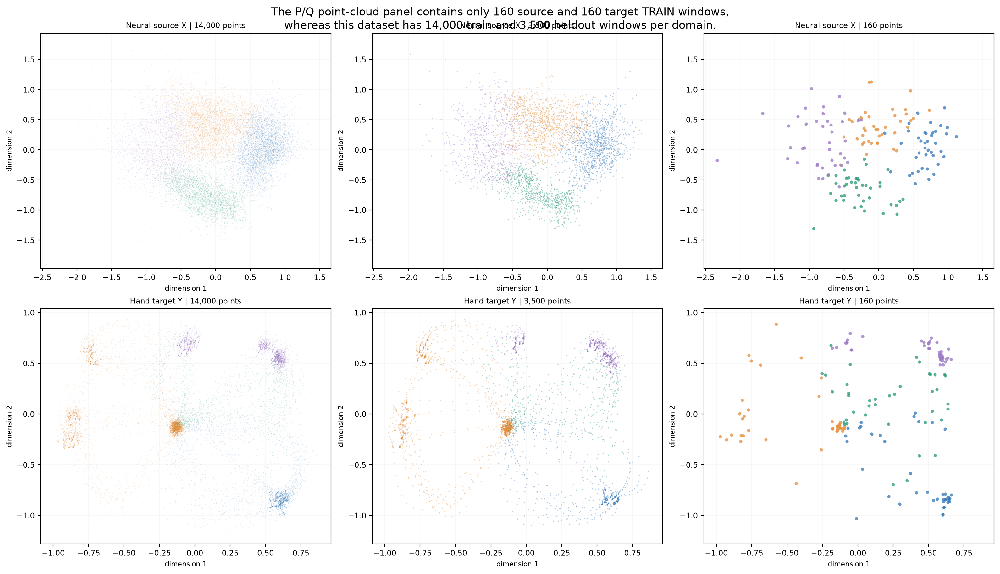
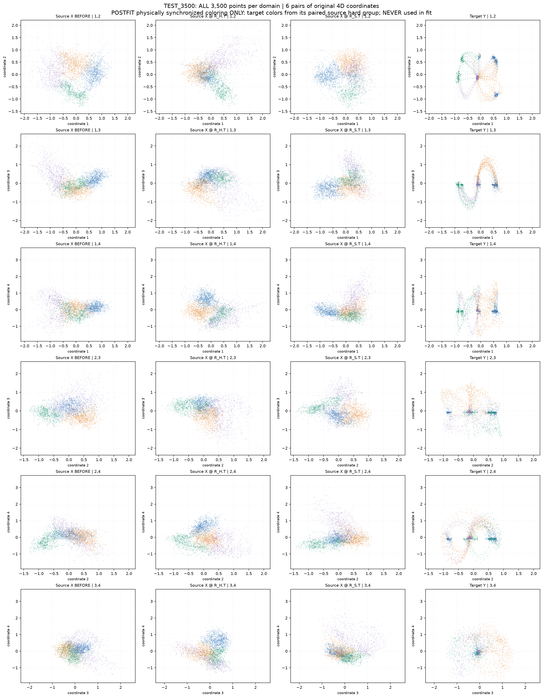
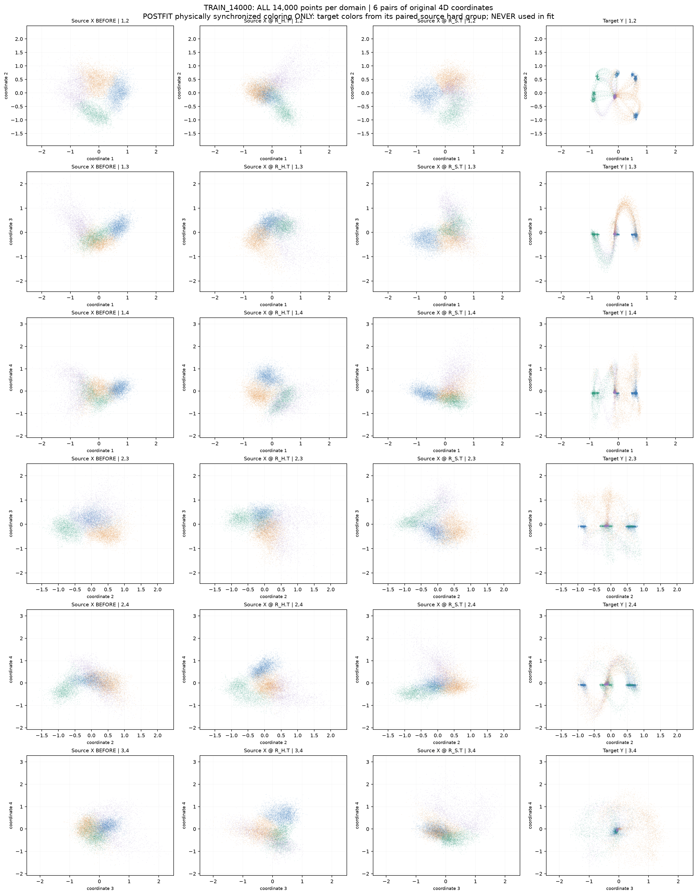
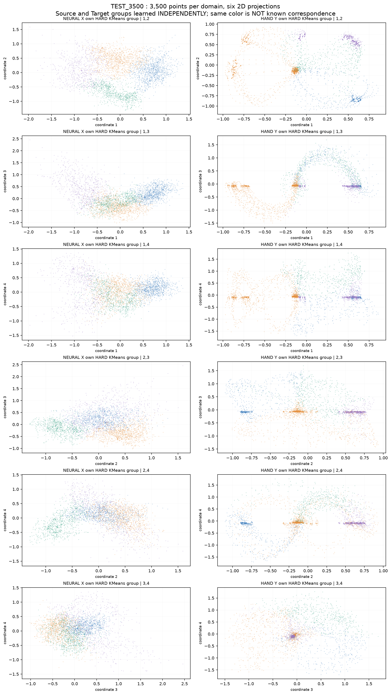
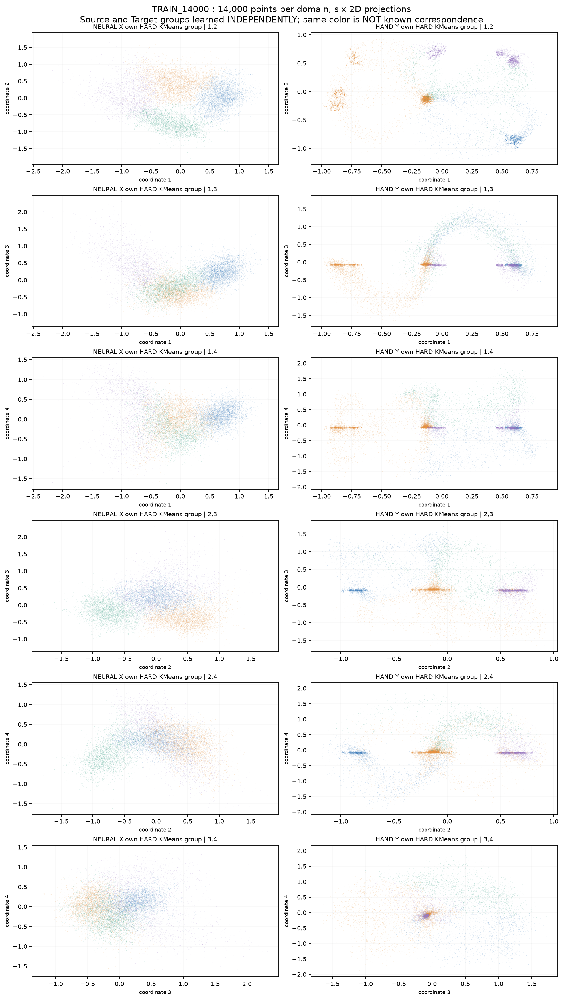
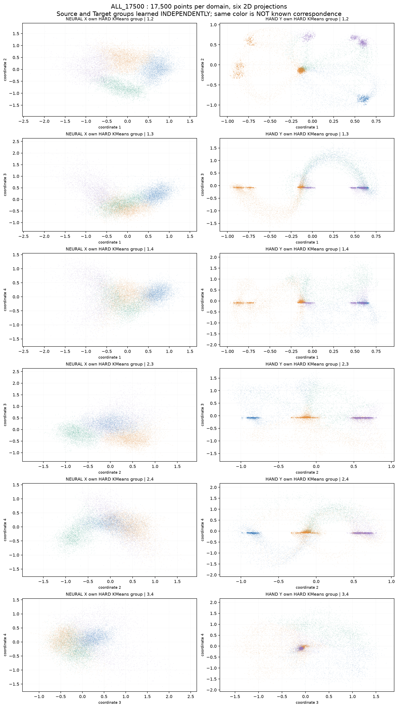
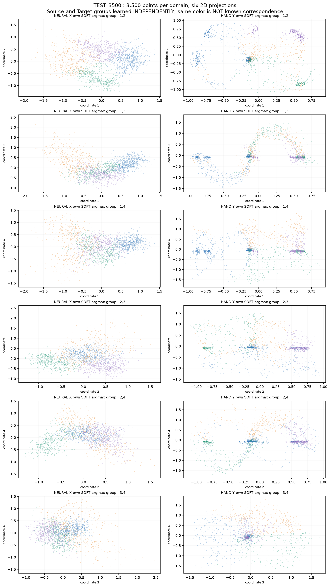

# 原DANDI四维数据散点图库 — 全样本核查

本图集**仅重绘**现有严格无监督实验，不重新拟合模型、不改变聚类或传输矩阵。之前 P-Q 图每域只画160个训练点，不能代表本项目的全部17,500个时间窗。

500有效试次，按运动开始时间对齐，各35个20ms窗口（-100到+600ms），162个神经元；原400/100试次拆分为14,000训练、3,500测试窗口。神经域放电频率sqrt、按时间σ=40ms高斯平滑、按训练zscore、PCA4（未白化）；手部位置xy和速度xy按训练zscore。之后两域分别用训练RMS半径归一化。
神经四维累计解释标准化神经方差：13.06%。

## 160点、3500点、14000点同尺度对比

## 3500个完整测试点，共同同步物理样本着色（仅训练后）

## 14000个完整训练点，共同同步物理样本着色（仅训练后）

## 3500测试点各域独立Hard分组

## 14000训练点各域独立Hard分组

## 17500全部点各域独立Hard分组

## 3500完整测试点各域独立Soft原型最大归属分组

注意：共同同步颜色**仅用于绘图**，Target训练簇不是Source复制标签；独立Hard与Soft图中的同编号组不等于已知组对应。左右所有点都在已有四维归一化坐标的二维投影；Source对齐列为原同一批点乘不同的正交R。每个点对应20ms窗口，不能把17500个窗当17500个独立试次。

[计数、PCA、样本行索引及来源核验](FULL_SCATTER_DATA_AUDIT.json)
