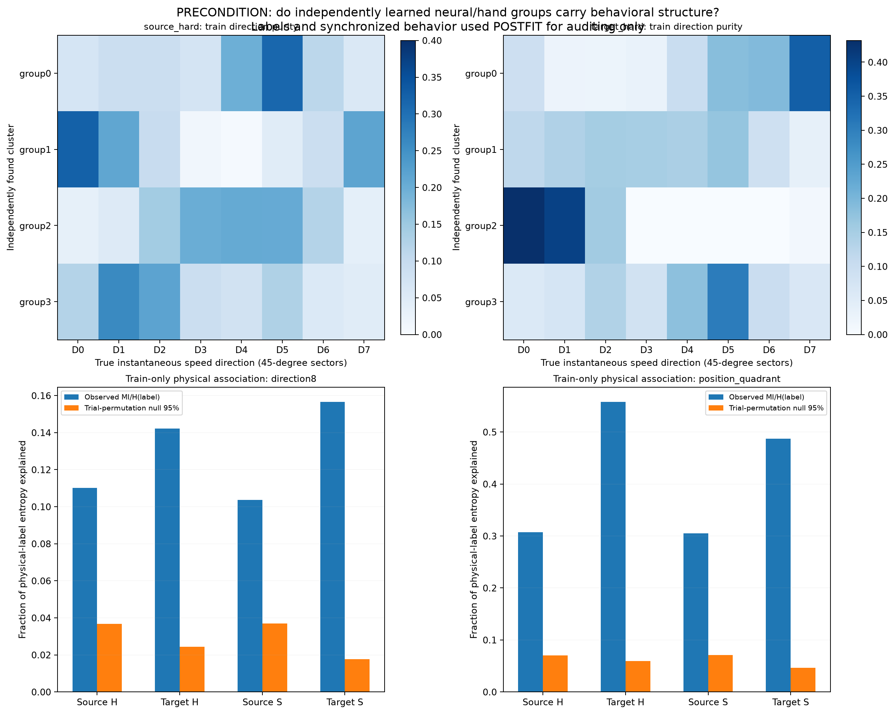
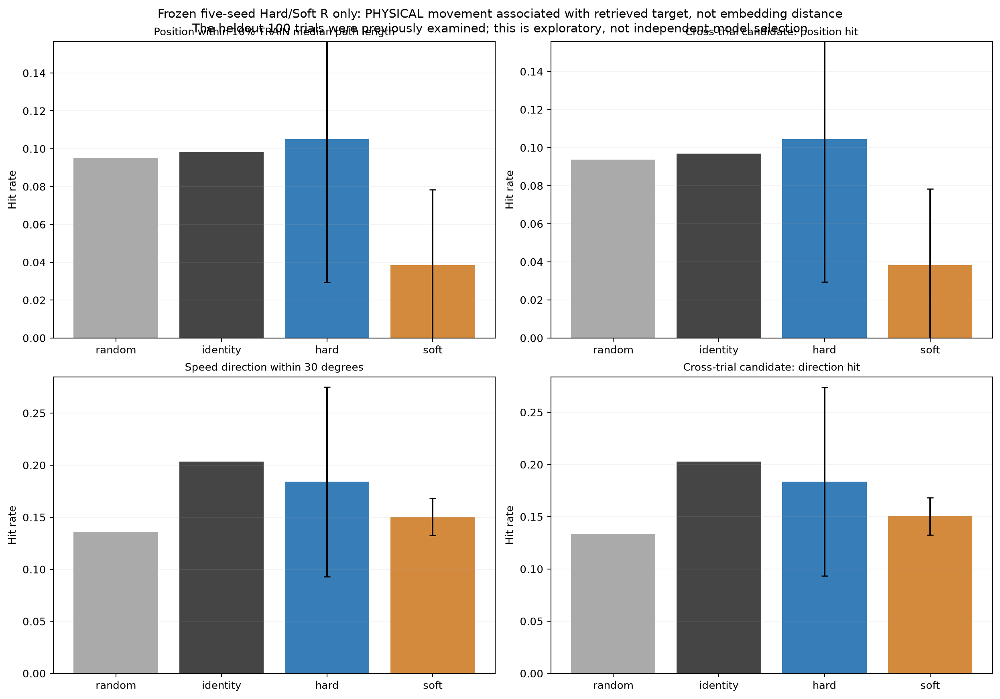

# DANDI000138 | Phase-I preflight: does our EXISTING 4D data have recoverable physical cluster geometry?

**This is a completed read-only preflight on the existing five-seed strict unpaired model. No R/P/Q/refitting changed; sample levels remain 17500/14000/3500/160.**

## Predeclared evaluation scales (from TRAIN hand trajectories only)

- Median total path length per 35-bin training trial: 182.33 native hand position units; position tolerances at 5%/10%/20% of this reference. NWB position unit metadata has **not** been verified.
- Speed threshold: 20th train speed percentile 10.5253 native velocity units; low true velocity excluded from angular accuracy; matched slow velocity counted as an angular failure.
- Actual train directions: instantaneous velocity angle quantized into 8 sectors; this is **NOT** a reach target condition label.
- Physical labels/synchronized true samples used **only AFTER original models were trained**, for diagnostic and evaluation; never used to choose matching points or model parameters.
- Candidate matches: all 3500 test target points, and separate cross-trial-only candidate pool; compare Identity, uniform random target, HardR, SoftR. True match ID not supplied to search.

## Train-only cluster semantics (fraction of motion-direction entropy explained)

| Independently learned groups | Train direction MI/H | Trial-block shuffled 95% null | Test MI/H (exploratory) | Train motion position MI/H |
|---|---:|---:|---:|---:|
| source_hard | 0.11024 | 0.03665 | 0.11126 | 0.30715 |
| target_hard | 0.14218 | 0.02434 | 0.13763 | 0.55803 |
| source_soft | 0.10359 | 0.03701 | 0.10146 | 0.30491 |
| target_soft | 0.15661 | 0.01759 | 0.15856 | 0.48740 |

## Original physical position and instantaneous movement angle retrieval

Do not confuse low feature nearest-neighbor distance with physical match correctness. Test true position/velocity is read only once nearest target indices are fixed.

| Matching method | Pool | Position hit ≤10% train path | Speed angle ≤30° | Speed 8-sector accuracy | Position median error (native units) |
|---|---|---:|---:|---:|---:|
| random | full_pool | 0.0951 | 0.1359 | 0.1009 | 124.85 |
| identity | full_pool | 0.0983 | 0.2036 | 0.1568 | 112.26 |
| hard | full_pool | 0.1051 | 0.1841 | 0.1400 | 107.55 |
| soft | full_pool | 0.0385 | 0.1503 | 0.1088 | 139.54 |
| random | cross_trial_pool | 0.0937 | 0.1337 | 0.1002 | 125.32 |
| identity | cross_trial_pool | 0.0969 | 0.2029 | 0.1571 | 112.56 |
| hard | cross_trial_pool | 0.1044 | 0.1836 | 0.1390 | 107.55 |
| soft | cross_trial_pool | 0.0383 | 0.1504 | 0.1087 | 139.54 |

## Independent unpaired centroid structure

- Best group-centroid distance discrepancy over 24 independent group permutations: 0.08159. This alone cannot prove paired physical correspondence.

## PREDECLARED GO / NO-GO exploratory heuristic

- Train neural hard-group direction semantic gate: **True**.
- Cross-trial physical 1NN matching seed gate passes: hard **2/5**, soft **0/5**.
- Strict solver residual convergence: hard **5/5**, soft **0/5**.
- Result: **AMBER_MIXED_PRECONDITIONS; DO_NOT_LAUNCH_FULL_SOFT_ABLATION_YET**.

This gate addresses current PCA4+KMeans with fixed R+1NN only; it DOES NOT establish failure/success of other latent representations or full Gamma-based hierarchical transport.

## Critical limitations

1. This experiment reuses heldout 100 trials previously inspected in research, so it is an **exploratory audit**. Future PCA4/FA4/Isomap decisions MUST use train-internal validation rather than test score tuning; a fresh independent confirmation set is desirable.
2. Trial-block permutations preserve within-trial temporal structure and approximate epoch effects, but 500 trials are from one recording/session and are not independent subjects.
3. Present target retrieval is **transductive** and uses R-only 1NN. It does not yet evaluate target-aware recalculated Q/Gamma, which must be conducted in a separate predeclared OT-matching phase.
4. The hand physics is scored in its archived raw numeric coordinate system. NWB unit metadata not checked, so tolerance is tied to a preregistered training path-length reference rather than invented centimeters.

[Detailed frozen-model/semantic/seed audit JSON](PREFLIGHT_DATA_AND_EVALUATION_AUDIT.json) | [Original strict unpaired training](../../code/run_strict_unsupervised_hard_soft.py) | [This test-only diagnostic code](../../code/preflight_geometry_semantics_retrieval.py) | [Next-stage full protocol](../../NEXT_STAGE_EXPERIMENT_PROTOCOL.md)
