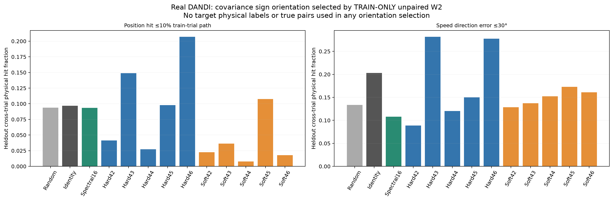

# DANDI138: can train-only unpaired covariance orientation give a better starting rotation?

**Fully read-only**; it does not refit or change R/P/Q in archived HiWA. All candidate orientation selection occurs on 400 independent source+target train observations per domain; test physical labels are consulted only after choosing one fixed sign candidate by train W2.

- 16 covariance-eigenaxis sign candidates; selected sign=[-1, 1, 1, 1], train W2²=0.344837
- This is a cheap initializer feasibility check, not a full hierarchical optimizer; it does not include P or Q. Must NEVER claim it is directly comparable to HiWA as a complete model.

| Rotation / method | Heldout CROSS-TRIAL position hit10% | Speed direction hit30° |
|---|---:|---:|
| Random | 0.0937 | 0.1337 |
| Identity | 0.0969 | 0.2029 |
| Spectral16 | 0.0934 | 0.1081 |
| Hard42 | 0.0414 | 0.0886 |
| Hard43 | 0.1489 | 0.2814 |
| Hard44 | 0.0271 | 0.1204 |
| Hard45 | 0.0977 | 0.1499 |
| Hard46 | 0.2069 | 0.2775 |
| Soft42 | 0.0226 | 0.1286 |
| Soft43 | 0.0363 | 0.1373 |
| Soft44 | 0.0077 | 0.1524 |
| Soft45 | 0.1074 | 0.1730 |
| Soft46 | 0.0177 | 0.1607 |

The heldout trial set was already examined previously; do not use these observed scores to tune candidate families or select future hyperparameters. If spectral initialization is to be integrated, use strictly training-internal validation for algorithm decisions, then confirm on a new independent trial/session when possible.

[Complete per-seed original solver and train-only candidate score audit](DANDI_TRAIN_ONLY_SPECTRAL_GEOMETRY_PREFLIGHT.json) | [Reproducible script](../../code/preflight_real_spectral_orientation.py)
