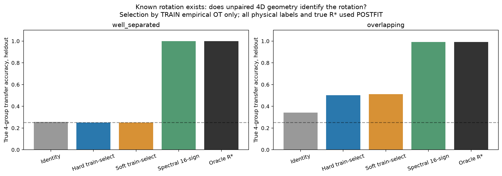

# Preflight unpaired covariance sign search: isolate geometry identifiability vs solver initialization

Original 4-cluster synthetic positive control with known 4D true R*; neither R* nor any true group labels or per-point correspondence are used for training. Both domains independently sampled from common mixtures.

We calculate covariance principal eigenvectors separately on X,Y TRAIN-only, enumerate 16 sign choices, select one by the MINIMUM 240×240 unpaired training empirical squared Wasserstein assignment cost, then evaluate the heldout true-group labels. This search is not the HiWA solver and never uses P/Q.

| Simulation | Procedure | Train unpaired W2²↓ | Heldout true 4-group 1NN accuracy↑ |
|---|---|---:|---:|
| well_separated | Identity | 0.957413 | 0.2556 |
| well_separated | Hard random solver, selected train-only | 0.086706 | 0.2500 |
| well_separated | Soft random solver, selected train-only | 0.095540 | 0.2500 |
| well_separated | Covariance eigen-sign, train-only | 0.119559 | 1.0000 |
| well_separated | True R* oracle (evaluation only) | 0.118242 | 1.0000 |
| overlapping | Identity | 0.572708 | 0.3417 |
| overlapping | Hard random solver, selected train-only | 0.107243 | 0.5028 |
| overlapping | Soft random solver, selected train-only | 0.109929 | 0.5111 |
| overlapping | Covariance eigen-sign, train-only | 0.090998 | 0.9917 |
| overlapping | True R* oracle (evaluation only) | 0.082218 | 0.9917 |

If train-only spectral orientation recovers physical truth but original solver misses it, optimization/initialization is implicated, rather than absence of shared orthogonal geometry. If neither recovers truth, this experiment alone cannot separate noisy eigenbasis estimation from intrinsic geometry ambiguity.

[All 16 candidates and original seed train-only selection](SPECTRAL_GEOMETRY_POSITIVE_CONTROL.json) | [Code](../../code/preflight_spectral_alignment_control.py)
