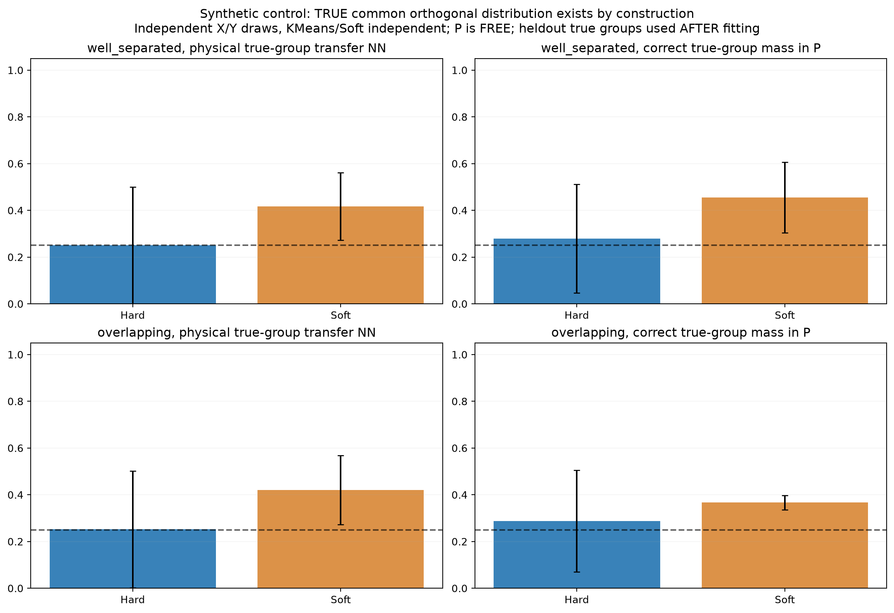

# Synthetic positive-control: before any expensive new real-data model

**The two domains are independent samples from the SAME four asymmetric Gaussian cluster distributions, up to one known orthogonal rotation R*.** Ground truth is used ONLY after fitting; independent K-means / soft prototypes are learned on each domain, and P is freely optimized. This is a necessary algorithm positive control, not DANDI evidence.

Solver control: original DANDI budgets (outer500/inner20/sample Sinkhorn45/group Sinkhorn200, eps_s=.1,eps_g=.2,mu=.05); same sampling 40 per hard group, 160/domain, seeds 42–44.

| Geometry regime | Method | Heldout true-group 1NN acc↑ | Identity 1NN acc | P true-group mass↑ (chance=.25) | Rgt Frobenius error↓ | Strict ADMM |
|---|---|---:|---:|---:|---:|---:|
| well_separated | hard | 0.2500 | 0.2556 | 0.2789 | 3.1640 | 3/3 |
| well_separated | soft | 0.4167 | 0.2556 | 0.4548 | 2.9637 | 3/3 |
| overlapping | hard | 0.2519 | 0.3417 | 0.2869 | 3.1710 | 3/3 |
| overlapping | soft | 0.4204 | 0.3417 | 0.3666 | 2.9649 | 0/3 |

**Interpretation**: The ground-truth class labels do NOT enter training. Synthetic recovery demonstrates only behavior under this designed known structure. Compare to the real DANDI read-only preflight to separate algorithm pathologies from poor real-domain representation.

[Seed-level P, R, ground truth accuracy audit](SYNTHETIC_POSITIVE_CONTROL_RESULTS.json) | [Generator and code](../../code/preflight_synthetic_positive_control.py)
