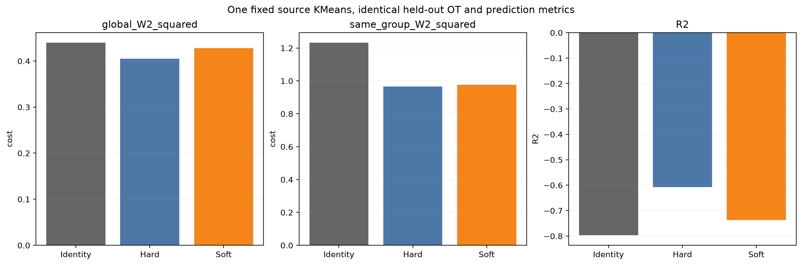
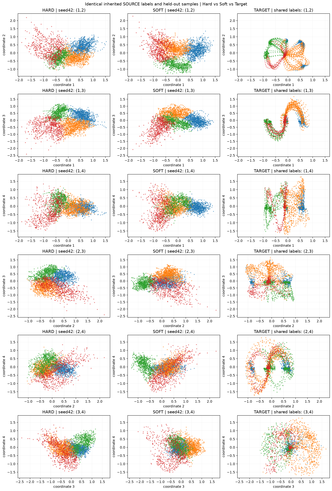

# 软分组与硬分组对照：DANDI 000138 同一四维同一标签体系

**严格协议：**源域固定一次 KMeans 得到四个原型，
目标软隶属度直接继承同步源时间窗的软隶属度；
所有可视化仍用原来相同的 argmax 硬标签着色，不存在目标域独立聚类。
软求解使用压缩包的原始 GCOT 分层 OT 函数与归一化加权测度，
额外关闭源/目标各自独立学习原型的步骤以满足既定协议。
**因此这是一种 source-constrained Soft-GCOT 变体，而非 TPAMI 原作者的无配对配置。**

温度 tau=0.4，训练软分组平均归一化熵=0.2677；
每次用于原版软算法的样本池=160，每个组在这些样本上都有正的概率质量。
外循环最多=500、局部交替最多=20、样本 Sinkhorn 最多=45；若与 Hard 的 500/20/45 不一致，属计算预算不同的试验性对照，不能仅凭此声称 soft 更优。

| 指标 | Identity | Hard mean ± sample SD | Soft mean ± sample SD |
|---|---:|---:|---:|
| Global OT W2^2 | 0.439478 | 0.404823 ± 0.043670 | 0.427863 ± 0.036529 |
| Fixed SAME-GROUP OT W2^2 | 1.231750 | 0.966421 ± 0.290070 | 0.975910 ± 0.213941 |
| MAE | 0.531486 | 0.497667 ± 0.055478 | 0.522147 ± 0.029285 |
| R2 | -0.796486 | -0.607383 ± 0.303137 | -0.736857 ± 0.163375 |
| 1NN inherited-label | 0.231429 | 0.377429 ± 0.216217 | 0.345714 ± 0.171914 |

## 每个软模型 seed

| seed | 4D全域OT W2² | 固定组OT W2² | 1NN | MAE | R2 | 收敛审计 |
|---:|---:|---:|---:|---:|---:|:---:|
| 42 | 0.417240 | 0.952565 | 0.3983 | 0.51898 | -0.72998 | PASS |
| 43 | 0.423269 | 0.811645 | 0.4954 | 0.49329 | -0.57214 | PASS |
| 44 | 0.440614 | 1.226428 | 0.1583 | 0.56995 | -1.00818 | PASS |
| 45 | 0.479284 | 0.731365 | 0.5083 | 0.50483 | -0.66470 | PASS |
| 46 | 0.378907 | 1.157549 | 0.1683 | 0.52368 | -0.70928 | PASS |

## 限制

- 只有全部种子严格满足收敛与相同数值预算时才能给出强对照结论，未通过的结果必须如实列出。
- Hard 使用原版 PyHiWA，Soft 使用同一上传压缩包中的 GCOT 求解器，除了隶属度，求解器数值实现也存在差异。因此当前是方法级对照，不是仅替换 membership 的纯消融。
- 共享组标签来自真实样本配对；1NN 不是独立运动标签分类指标。
- 模型最终仍输出全局正交旋转，OT 计划负责学习和优化而不是直接将样本搬成新点云。

## 可复现性

源数据哈希：a3b4394c199c658ffd9bc27b96de8309e3984cc367edc6f708b77e86c3140121
Hard 实验哈希：4a58663844c0da611f996b5ceba4b1f0e8aa075c0f7ab63584989b8ecb93ba59
