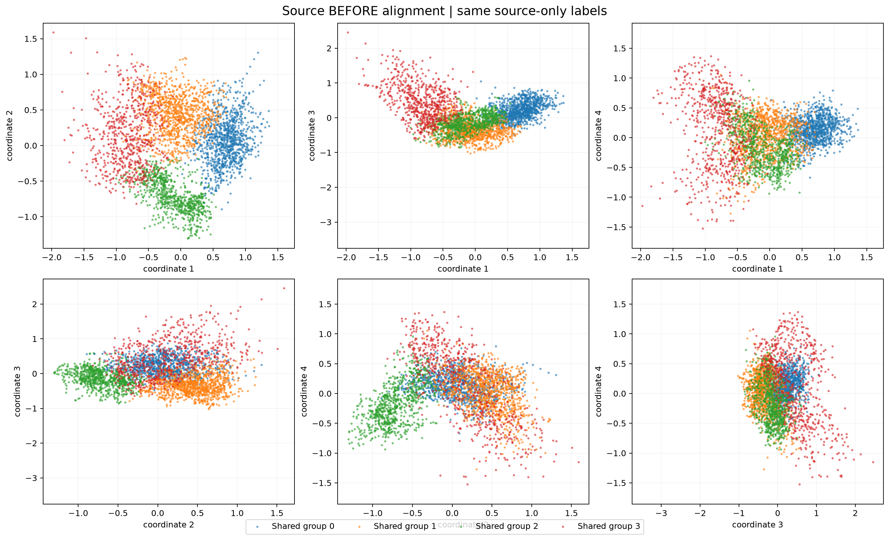
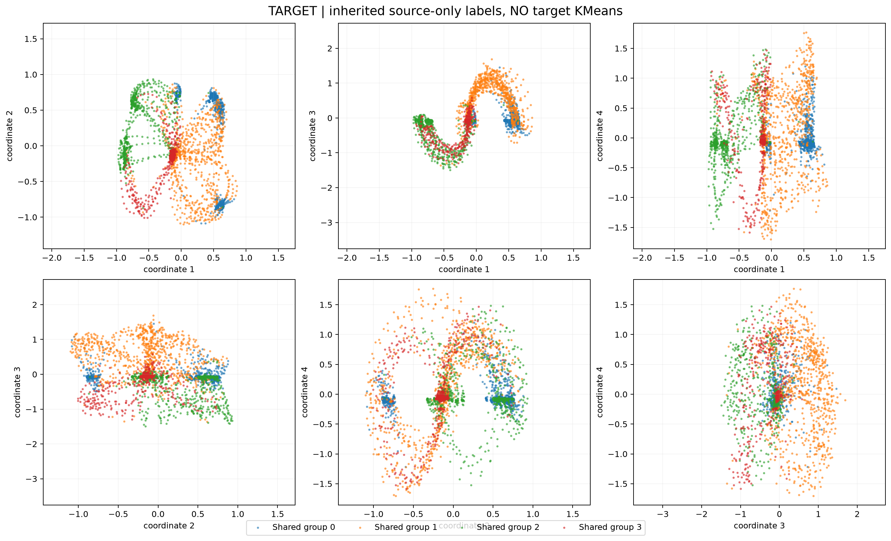
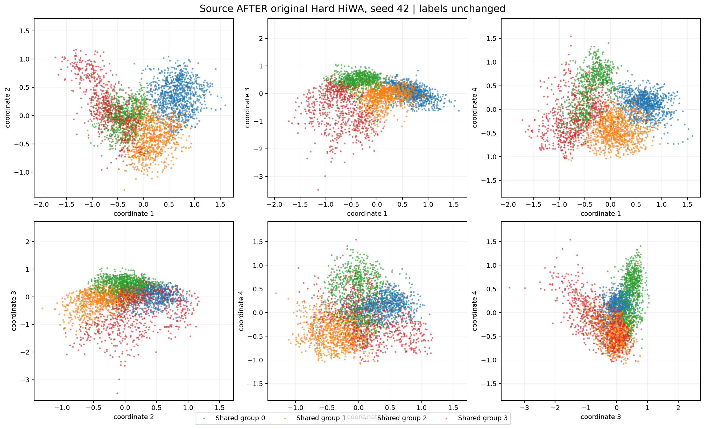
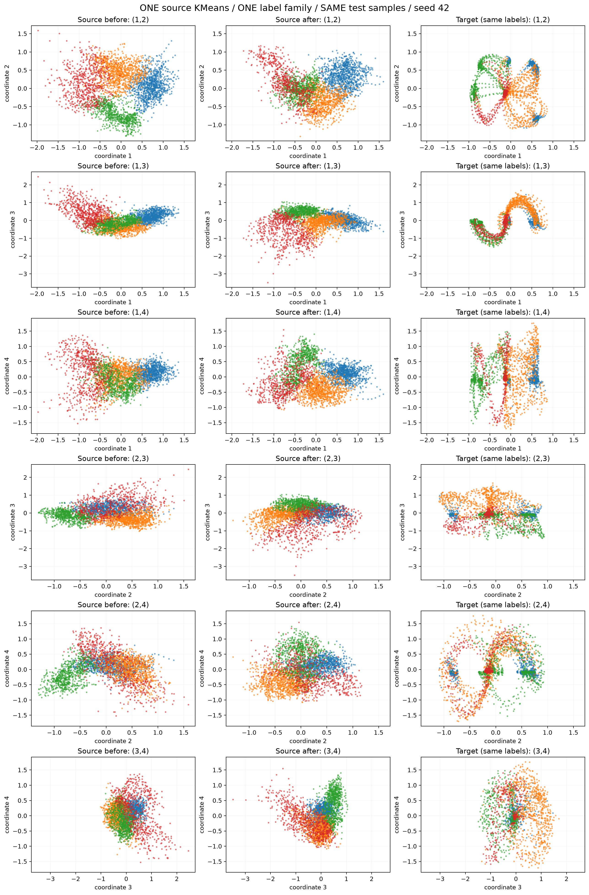

# DANDI 000138 — 单次源域 K-means 固定分组 Hard HiWA

**当前正式版本；之前两域独立 K-means 的结果仅作历史归档。**
4D 数据来自 DANDI 000138 0.220113.0407 的已验证四维缓存：
神经 162 units → 20ms spikes → sqrt → smoothing → train zscore → PCA(4)；
目标保留原生位置与速度四维，无 PCA；400/100 trials 分割。

## 从始至终只有一套组

仅使用训练神经数据拟合一次 K-means(K=4,n_init=20,seed=42)。
将每个神经时间窗标签按同步索引原封不动赋给手部时间窗；测试标签
由训练源域 K-means 预测，随后同样复制给对应测试目标。
HiWA 只对源域施加其全局正交矩阵，不得重新计算标签。
**注意：这一步使用真实配对信息，属于带有对应监督的分组协议，
不能再宣称是严格无配对分组发现。**

源域/目标域相同的训练组大小：[4137, 4316, 3146, 2401]
源数据缓存 SHA256：adb71e375cffae2105a0aa37fb26ee6f7be4c331b72b132c8b1c1ea067615fd7
全局标签 SHA256：cc6056c539fe62449d6f799d50d56819b29daebd03aed67a34a9b00eeb982307

## Hard HiWA 原版，重新拟合

调用 code/hiwa_original.py 原版，采用每域每组 40 点，
算法 5 seeds 42–46，outer=140，mu=.05，group gamma=.2，local gamma=.1。
种子 42 为预先指定绘图案例，不根据测试指标筛选最优图。

## 留出测试结果（相同四维、相同归一化、相同配对）

| 变换 | 共享标签 1NN↑ | MAE↓ | 配对 rMSE↓ | 旋转 rMSE 代理↓ | R²↑ |
|---|---:|---:|---:|---:|---:|
| Identity | 23.14% | 0.53149 | 1.79266 | 1.96470 | -0.79649 |
| Hard HiWA seed 42 | 41.34% | 0.49523 | 1.62760 | 1.52446 | -0.63108 |
| Hard HiWA seed 43 | 50.46% | 0.47867 | 1.52829 | 1.65050 | -0.53155 |
| Hard HiWA seed 44 | 49.14% | 0.48003 | 1.44873 | 0.93775 | -0.45183 |
| Hard HiWA seed 45 | 30.49% | 0.51695 | 1.70694 | 1.49077 | -0.71058 |
| Hard HiWA seed 46 | 15.11% | 0.53122 | 1.75215 | 1.92313 | -0.75589 |
| **五次均值 ± 样本标准差** | 37.31% ± 14.73% | 0.50042 ± 0.02312 | 1.61274 ± 0.12506 | 1.50532 ± 0.35998 | -0.61619 ± 0.12533 |

## 指标定义和限制

- 1NN：目标测试点查询对齐源域测试点中的最近邻，比较该最近源标签
与目标继承标签。目标标签由已知配对提供，不能解释为独立类别识别准确率。
- MAE：测试配对样本四维坐标平均绝对误差，量纲为归一化坐标。
- 配对 rMSE：SSE / sum(||target||²)，没有开根号，
用于评价实际同步配对，不等同于作者真实旋转 rMSE。
- 旋转 rMSE 代理：复用作者 _rMSE 函数，用训练配对最优正交
Procrustes 作为参照旋转，而不是不存在的真值 Rgt。
- 标准 R²：测试集 1-SSE/SST；原版内部 R² 算法非标准，
这里修正评价公式，不动求解器。

## 固定标签的实验图

[第一二维横向三图](before_after_target_xy.png)；
[各种指标比较](frozen_label_metrics.png)

## 科学解释

该协议使用已知配对传播标签，不能与旧版两域独立聚类
当作仅改变优化器的公平消融。两域均按原各自 RMS 半径归一化。
所有数据、组标签、旋转与逐种子结果均保存在本目录。
原版 PyHiWA SHA256：4419e19004b06c7840d187ddb12a19b2ad97974dd28ad1dc9510d8ead741da6a
数值收敛标记：[False, False, False, True, True]
