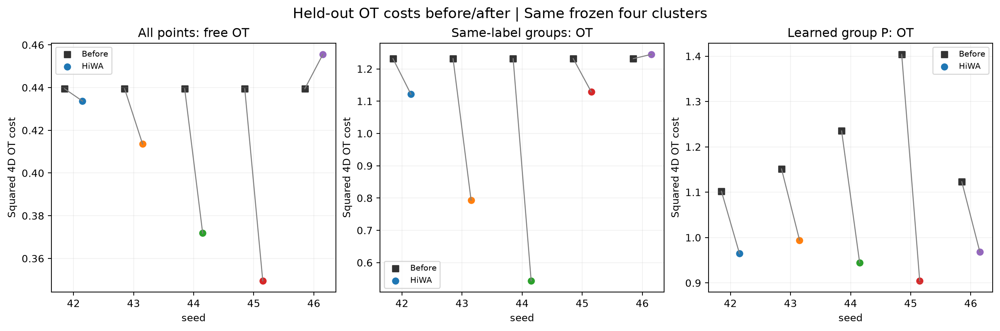
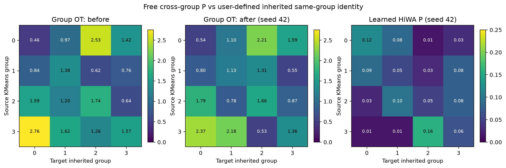

# 固定组 Hard HiWA：留出测试集最优传输代价

本轮只评估此前已经保存的五组 HiWA 全局旋转 R 和 4x4 簇间传输矩阵 P，完全没有重新训练、重新聚类或修改样本标签。
所有下列 W2² 均为归一化四维欧氏距离的平方，单位无量纲。

## 三种不同的 OT 问题

- 全局自由 OT：两个域的测试样本各抽 200 个，最小代价一对一匹配，允许跨组传输，与此前 hard_hiwa_results.json 中的 ot_rmse 完全一致。
- 同编号组 OT：目标继承神经源域的组号，只允许组 k 对组 k，每组在两域各独立抽取 128 个测试点，并按测试集经验组质量加权。
- 原版求解器学到的 P 加权组间代价：固定每个 seed 原来的 P，比较 I 和全局 R 下 16 个组对的精确测试 OT 代价加权平均。这里允许非对角传输，仅为测试代理，不是原版嵌套目标的精确损失：原版局部 R_ij 和 Q_ij 未保存，熵正则项也没有纳入。

测试组质量：[0.288857, 0.295143, 0.222, 0.194]。

## 均值（五个随机种子）

| 代价指标（越低越好） | 对齐前 | 对齐后均值 ± 样本标准差 | 相对改善 |
|---|---:|---:|---:|
| 全局自由 OT W2² | 0.43948 | 0.40482 ± 0.04367 | +7.89% |
| 共享标签同组 OT W2² | 1.23175 | 0.96642 ± 0.29007 | +21.54% |
| 等组质量同组 OT W2² | 1.28854 | 1.00729 ± 0.29376 | +21.83% |
| 原版 P 加权组间代价（P 固定） | 1.20303 | 0.95542 ± 0.03338 | +20.58% |

## 每个 seed 的 OT 代价
| seed | 全局自由 W2² | 同组 W2² | P 加权 before | P 加权 after | P 对角总质量 |
|---:|---:|---:|---:|---:|---:|
| 42 | 0.43367 | 1.12123 | 1.10197 | 0.96486 | 0.28574 |
| 43 | 0.41355 | 0.79346 | 1.15124 | 0.99413 | 0.42076 |
| 44 | 0.37181 | 0.54365 | 1.23501 | 0.94484 | 0.53384 |
| 45 | 0.34953 | 1.12888 | 1.40387 | 0.90460 | 0.26514 |
| 46 | 0.45555 | 1.24490 | 1.12306 | 0.96868 | 0.22243 |

## 如何解释
OT 分布误差小，不等于同一时刻的神经活动可以准确预测手部运动。两类误差评价目标不同。特别注意：用户要求的固定标签不代表原版 HiWA 的 P 被限制为对角阵；如果要只允许同组传输，应看上面的同编号组 OT，而不是直接把原版 P 当作组身份映射。

研究复现：模型和训练标签哈希已核对；对全局自由 OT 的每一轮计算均断言等于原有结果文件中的 ot_rmse。
