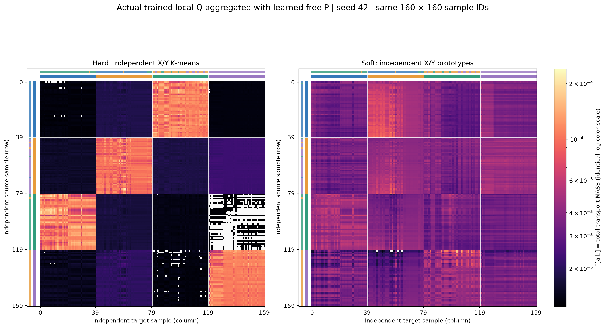
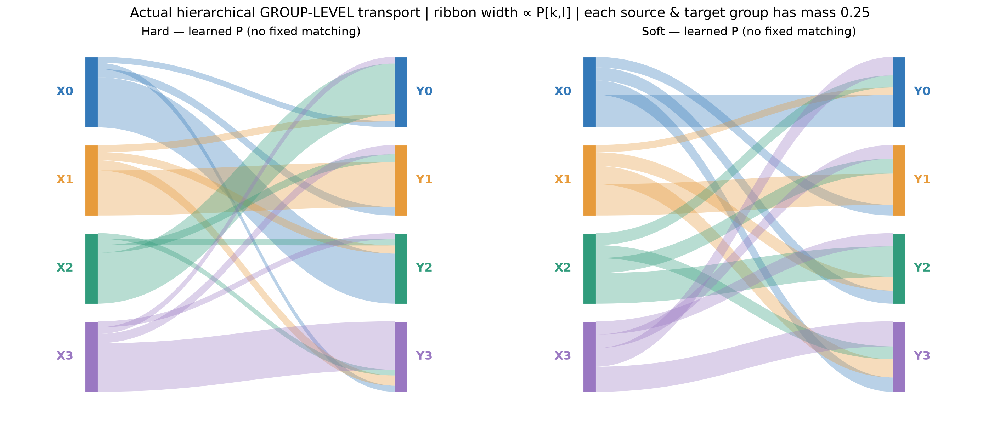
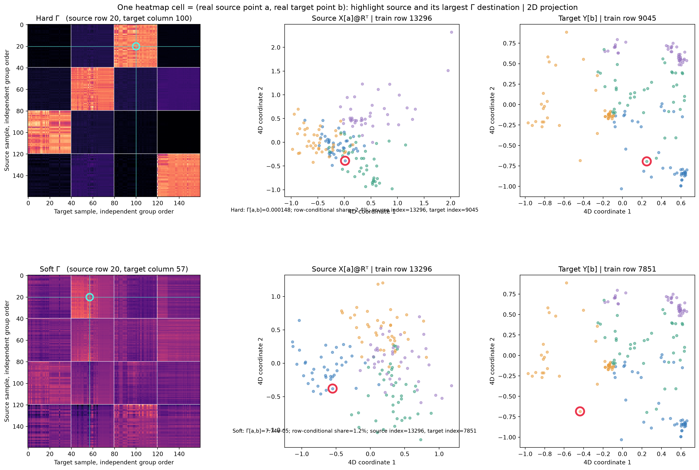
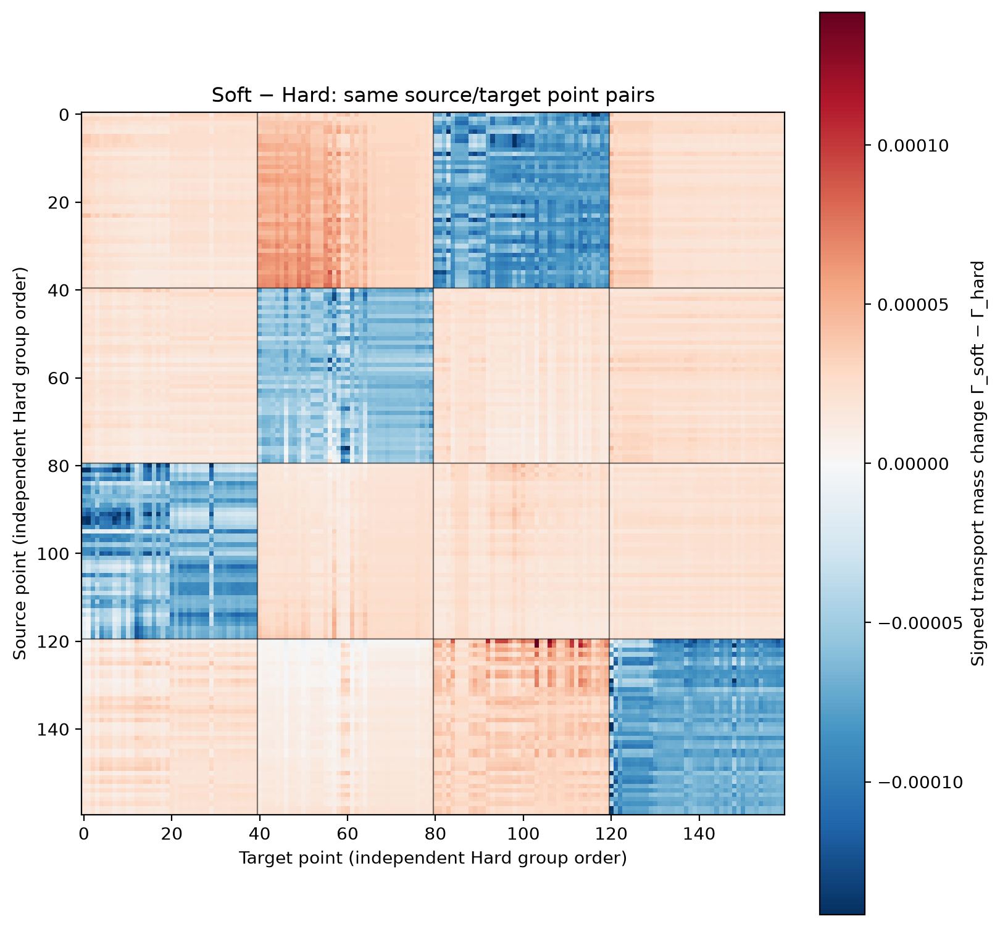

# 真实无监督 Hard/Soft 的分层 P-Q 传输可视化（seed 42）

## 核心图像

## 数学含义与严谨性

每种方法在同一批160个源域和160个目标域训练样本上，求得自己的源/目标**独立组**和真实学得的 P、Q。使用真实已拟合的 42号初始化重放原 ZIP-GCOT，逐元素检验 P/R 与正式归档完全一致（最大误差1e-9以下）；同一批点索引 SHA256 与归档一致。

构建样本级总传输：Γ[a,b] = Σ_{k,l} P[k,l] Q_{k,l}(a,b)。Hard 每个 Q[k,l] 是40x40，按该簇对实际样本索引嵌入160x160矩阵。Soft 每个 Q[k,l] 已是160x160，逐元素加权相加，**绝不可把同一批物理样本重复拼成640x640**。

大型热力图每个像素都对应原始 sampled row ID 的一个源点a和一个目标点b；行列排序在两种方法完全一致。行/列边缘粗色条是两域分别训练的 Hard K-means 组，细条是两域各自学得 Soft 原型的最大隶属组；**目标域的颜色不是由同步源样本标签复制**。

第3张图使用同一个源点（取独立Hard组0中间点），分别挑出Hard和Soft下它运量最大的一条真实源→目标边；矩阵位置、高亮散点、原始行索引和行内条件概率一一对应。点云只展示四维坐标中的前两维投影，二维距离不能冒充原始四维运输代价。

**IMPORTANT**：这16个局部 Q 是原始 GCOT 求解器最后一次局部迭代得到的 Q，而最后的 P 是该轮局部Q之后更新所得。两者与正式归档模型数值一致，但这里展示的不是保持最终P/R固定时重新求得的测试Q；也不是声称每个Q都在最终全局R下最优。

与旧监督实验完全隔离。源目标组的真实配对仅在拟合以后可用于对照上色，没参与此图的P/Q重建。Soft正式求解在seed42达到原定500外循环上限但未通过严格ADMM判据；图像忠实展示这一有数值限制的结果。

原始P/Q、两域160个真实训练样本行索引、4D坐标和组标签全部保存在 [actual_sample_level_P_Q_and_indices.npz](actual_sample_level_P_Q_and_indices.npz)，每个方法包含各16块局部Q和160x160总Γ。溯源与边际残差见 [VISUALIZATION_AUDIT.json](VISUALIZATION_AUDIT.json)。
