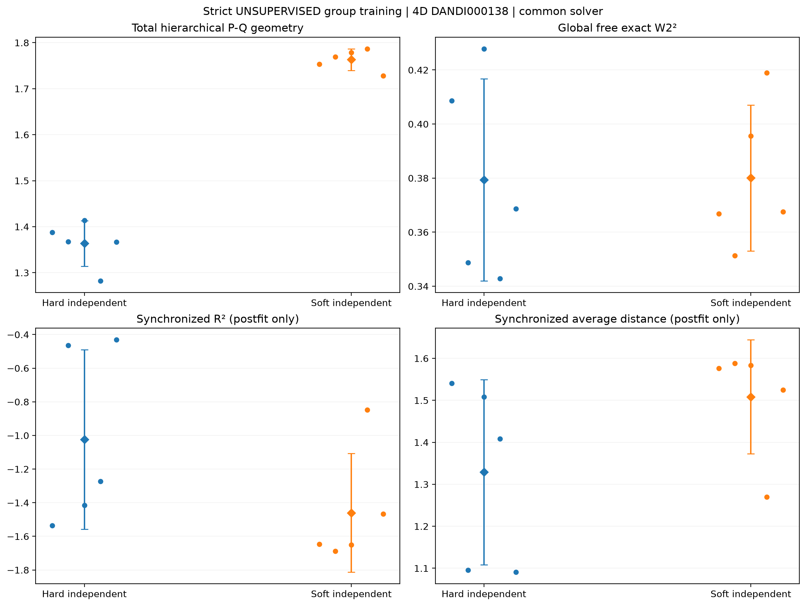
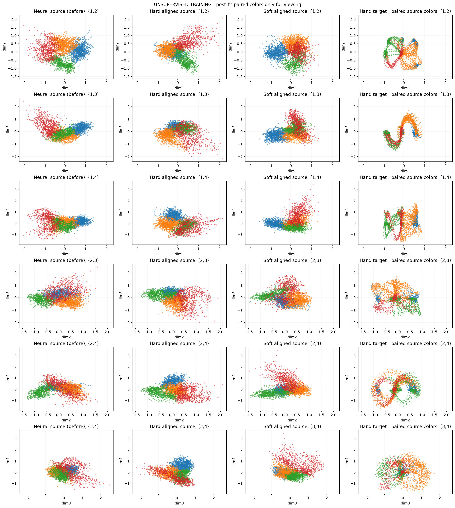
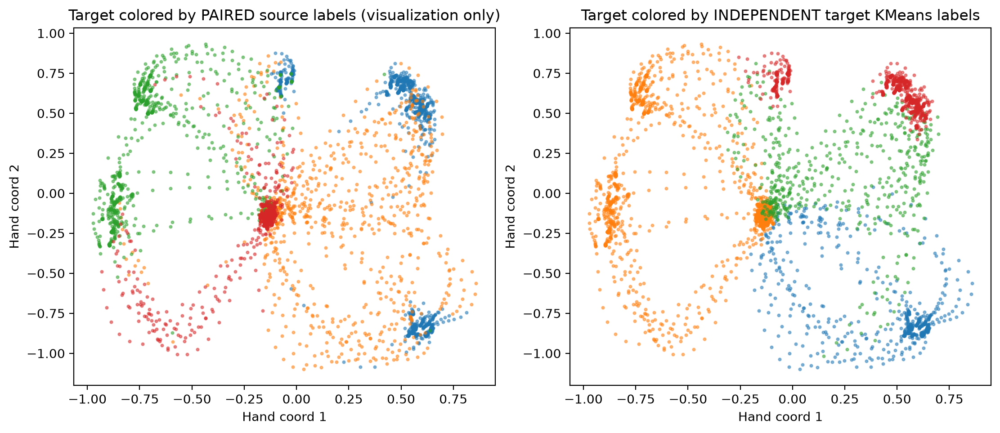

# Strict unpaired Hard-vs-Soft DANDI:000138 4D experiment

## Training grouping and correspondence isolation

Uses OLD original 17,500-window/500-trial four-dimensional dataset, NOT the source-only label copied file.
Hard: X and Y KMeans independently fitted by original run_hard_clustering.py.
Soft: directly use unchanged ZIP grouping.soft_groups(X_train) and grouping.soft_groups(Y_train) with distinct seeds.
The target soft B is predicted from **Y features and Y prototypes**; it is never copied from A.
Both methods call the same unchanged ZIP hierarchical_alignment with **free P**, same sample pools, same 500/20/45/200 limits, mu=.05, epsilon=.1/.2, scale=True, 5 seeds.
True synchronized indices are used exclusively *after* R/P fitting for paired errors and shared scatter colors.
No group label ordering/permutation chosen using paired identities; P learned by Sinkhorn.

## Heldout five-seed summary (mean ± sample SD)

| Metric | Unsupervised Hard | Unsupervised Soft |
|---|---:|---:|
| P-Q hierarchical geometry W2sq | 1.363597 ± 0.049492 | 1.763262 ± 0.023317 |
| Exact free global W2sq | 0.379350 ± 0.037392 | 0.380061 ± 0.027006 |
| Paired relative MSE (POSTFIT) | 2.019661 ± 0.532772 | 2.454564 ± 0.351690 |
| Paired mean Euclidean (POSTFIT) | 1.328862 ± 0.220298 | 1.508588 ± 0.135604 |
| MAE (POSTFIT) | 0.563081 ± 0.107866 | 0.636772 ± 0.053375 |
| R² (POSTFIT) | -1.023976 ± 0.533911 | -1.459808 ± 0.352441 |
| 1NN shared visualization color (POSTFIT) | 0.306171 ± 0.227689 | 0.112343 ± 0.164602 |
| Training P-Q geometry W2sq | 1.339884 ± 0.074316 | 1.865880 ± 0.063793 |
| Training raw entropy objective scaled | -11.917196 ± 0.015589 | -15.162065 ± 0.054343 |

## Residual/convergence audit
Passing a stop event or 500 iterations DOES NOT establish ADMM convergence.
Original ZIP residual fields: rotation_delta, consensus_residual, dual_residual,
primal_tolerance, dual_tolerance, coupling_delta, and sample/group marginal errors.
Two flags are reported: strict original ADMM criteria; comparable relaxed historical 0.01/0.04 thresholds.

| Method | Seed | Outer iters | ADMM pass | Relaxed pass | rotation | consensus | dual | Q train marginal | P marginal |
|---|---:|---:|:---:|:---:|---:|---:|---:|---:|---:|
| hard | 42 | 164 | Yes | Yes | 8.879e-10 | 1.767e-09 | 4.44e-11 | 4.6e-15 | 6.4e-10 |
| hard | 43 | 179 | Yes | Yes | 9.688e-10 | 1.912e-09 | 4.844e-11 | 1.1e-10 | 5.5e-11 |
| hard | 44 | 140 | Yes | Yes | 8.724e-10 | 2.077e-09 | 4.362e-11 | 1.3e-14 | 4.5e-09 |
| hard | 45 | 146 | Yes | Yes | 9.763e-10 | 2.378e-09 | 4.882e-11 | 5.7e-11 | 5.8e-10 |
| hard | 46 | 119 | Yes | Yes | 9.789e-10 | 2.727e-09 | 4.895e-11 | 5.5e-15 | 8.7e-09 |
| soft | 42 | 500 | No | Yes | 0.001933 | 0.001219 | 9.665e-05 | 1.5e-14 | 1.9e-11 |
| soft | 43 | 500 | No | Yes | 0.005238 | 0.00235 | 0.0002619 | 4.2e-16 | 4.1e-12 |
| soft | 44 | 500 | No | Yes | 0.0001735 | 9.605e-05 | 8.675e-06 | 2.4e-17 | 4.1e-13 |
| soft | 45 | 500 | No | Yes | 0.00273 | 0.001557 | 0.0001365 | 1.9e-15 | 3.9e-11 |
| soft | 46 | 500 | No | Yes | 6.526e-05 | 3.614e-05 | 3.263e-06 | 8.8e-15 | 1.5e-10 |

## Essential interpretation
- The test P-Q geometry excludes entropy terms, but evaluates an entropically obtained plan. It differs from original regularized training objective.
- The Hard and Soft group-conditional probability distributions themselves differ, so the numeric P-Q cost alone is not a fixed-measure proof of better predictive alignment.
- Global free W2² is a common, membership-independent distribution metric. Paired R²/MAE are postfit only and do not enter any model selection.
- Original HiWA/PyHiWA Hard is a separate solver, NOT the same-solver control. Its original independently clustered results/hard_hiwa/ can be examined separately; previously shared-label Hard/Soft studies are GROUP-SUPERVISED DIAGNOSTICS.
- Train/test trial split remains the original 400/100. All five seeds are reported; no best test R² seed selection.

