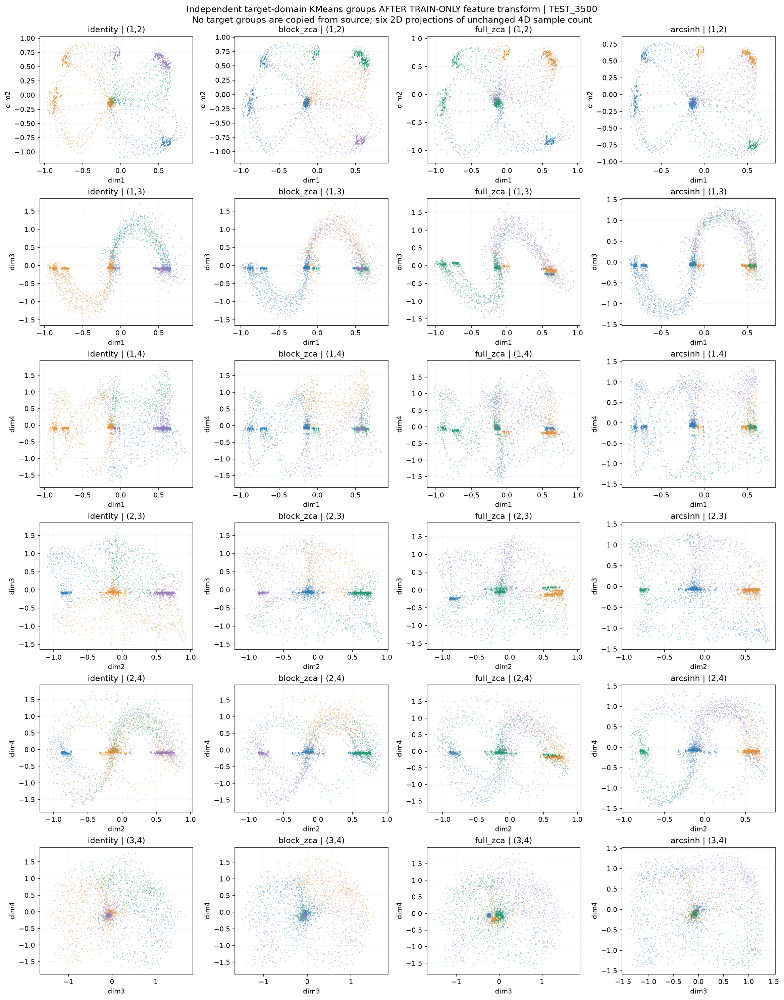
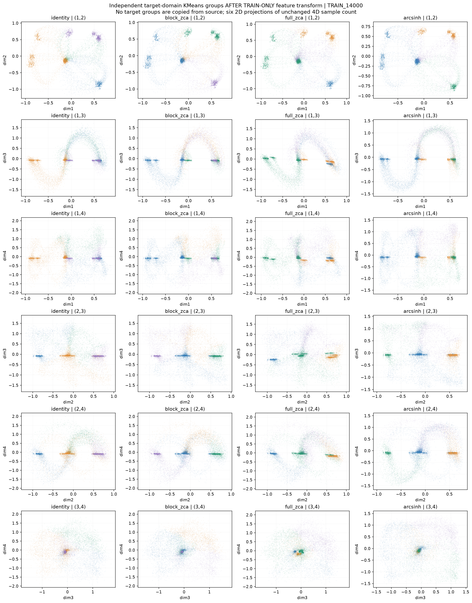
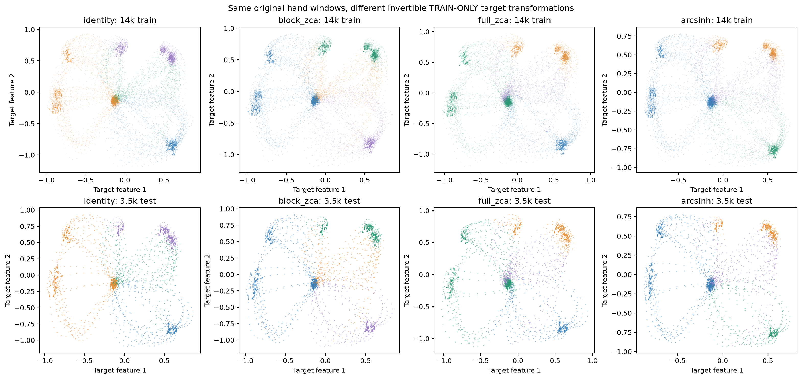
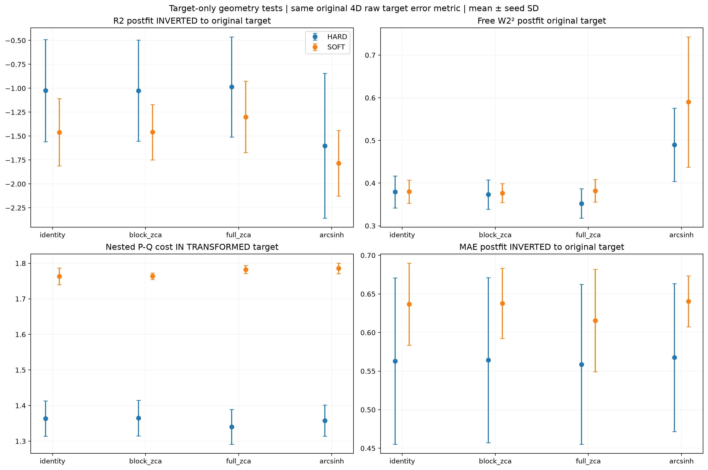
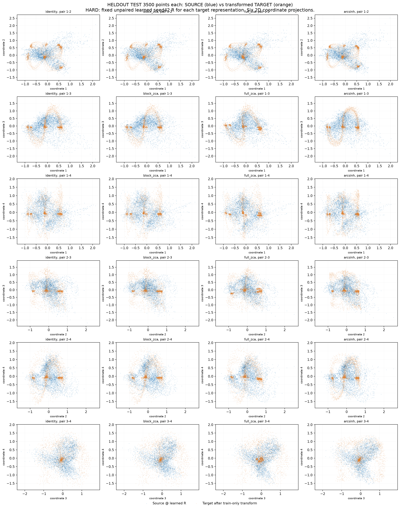
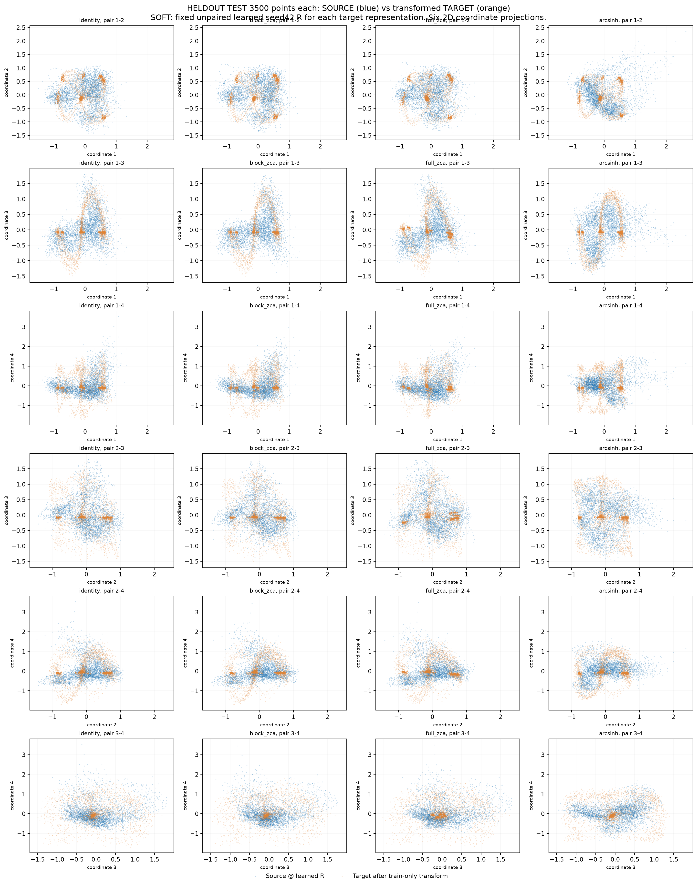
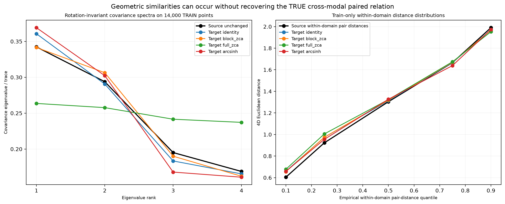
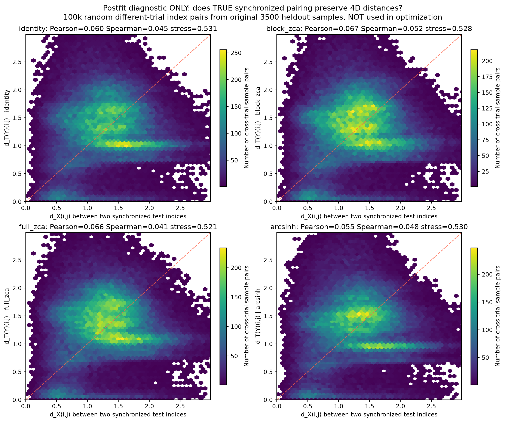

# DANDI:000138 | 目标域单侧无监督几何处理实验

**仅修改目标域的四维表示，神经域和原试次/窗口/求解器不变。**每一种目标变换仅使用14,000训练点的目标边际特征估计，禁止源目标同步索引和测试R²参与拟合或筛选。处理后Hard的目标KMeans和Soft目标原型各自重新训练；源域原分组固定。

预声明的4种方案：identity（原始基线）、block_zca（位置和速度各自2D shrinkage ZCA，λ=.15）、full_zca（4D shrinkage ZCA，λ=.15）、arcsinh（逐维训练集median和75%绝对偏差尺度做可逆反双曲正弦，压缩长尾，**不是解码跨模态非线性**）。每种变换后只在训练集上居中，缩放至RMS半径1。

**数据层级**：17500全部，14000训练，3500测试，求解器每域160点、40/组；K=4、seed 42–46、outer 500、inner 20、sample Sinkhorn45、group Sinkhorn200、µ=.05、eps_s=.1、eps_g=.2。

## 无配对训练形状诊断（旋转不变量；不能证明点对关系）

| 目标处理 | 源/目标协方差特征值比例 L2 差 ↓ | 两域点内距离分位数 L2 差 ↓ | 目标训练四组点数 |
|---|---:|---:|---|
| identity | 0.02223 | 0.07809 | [2818, 6316, 2012, 2854] |
| block_zca | 0.01513 | 0.07771 | [6323, 2005, 2893, 2779] |
| full_zca | 0.11980 | 0.11847 | [2556, 2935, 6319, 2190] |
| arcsinh | 0.03990 | 0.07458 | [6342, 2821, 2793, 2044] |

## 完全相同原始目标坐标下的逆变换后测试指标

| 目标处理 | 方法 | 原始Y空间R²↑ | 原始Y空间 MAE↓ | 原始Y空间自由W2²↓ | 处理后分层P-Q代价↓（不同度量不可直接排名） | 严格ADMM通过次数 |
|---|---|---:|---:|---:|---:|---:|
| identity | hard | -1.02398±0.53391 | 0.56308±0.10787 | 0.37935±0.03739 | 1.36360±0.04949 | 5/5 |
| identity | soft | -1.45981±0.35244 | 0.63677±0.05338 | 0.38006±0.02701 | 1.76326±0.02332 | 0/5 |
| block_zca | hard | -1.02563±0.52879 | 0.56427±0.10698 | 0.37321±0.03434 | 1.36467±0.04975 | 5/5 |
| block_zca | soft | -1.45878±0.28982 | 0.63772±0.04545 | 0.37681±0.02228 | 1.76371±0.00929 | 0/5 |
| full_zca | hard | -0.98558±0.52358 | 0.55872±0.10359 | 0.35244±0.03449 | 1.34021±0.04920 | 5/5 |
| full_zca | soft | -1.29953±0.37434 | 0.61545±0.06633 | 0.38218±0.02655 | 1.78232±0.01130 | 0/5 |
| arcsinh | hard | -1.60107±0.75704 | 0.56759±0.09595 | 0.48984±0.08601 | 1.35771±0.04389 | 5/5 |
| arcsinh | soft | -1.78388±0.34294 | 0.64047±0.03299 | 0.59019±0.15277 | 1.78582±0.01502 | 0/5 |

## 图像：完整3500测试点和14000训练点（六维投影组合）

## 原始 Source 与各变换 Target 的实际重叠图：全部3500测试点

使用五次模型中的 seed42 已保存正交 R，在所有六种二维坐标投影中同时绘制**蓝色 X@Rᵀ、橙色 T(Y)**。为了避免只挑单一‘好看’投影，六组投影全部提供，Hard 和 Soft 分开显示。每种变换的 3500 个 Target 测试点均是原样本的训练拟合变换，没有利用同步索引训练。

## 无配对的内在距离结构检查

请注意：两域特征值谱原本就相近。全4维白化把目标协方差趋近球形，反而使它与源 PCA 4D 的协方差谱距离增加；但原始目标坐标下的测试 Hard 全域 OT 有小幅改善。这证明外观形状、原始分布距离和真实物理点的准确对应是三个不同问题。

**统计局限：**每种方案各5次不同数值初始化，不是5个独立神经记录个体；目标 Hard KMeans 重拟合以后160个抽样目标点也会改变，因此变换效应与重新分组/训练子样本效应没有完全剥离。不能仅凭这次测试集排名选参，下一轮需用训练内部验证后再最终独立测试。

## 最重要的后验诊断：同步点的四维距离是否可由正交变换保持？

这项检验**仅在所有 Hard/Soft 拟合结束后**进行。从原3500个独立测试时间窗里抽取100,000个**不同试次**的真实同步索引对 (a,b)，比较神经域点间距 d_X(a,b)=||X_a−X_b|| 与各目标变换的运动域点间距 d_TY(a,b)=||T(Y_a)−T(Y_b)||，计算相关性。

如果跨域确实能由一个全局正交矩阵恢复同步映射，则根据欧氏距离不变性，这两组距离应非常接近。这是**必要而非充分**条件；这里只用于评价，绝不用于目标变换训练、最优传输拟合、求解初始化或任何超参选择。

| 目标域变换 | 真实同步跨试次点对距离 Pearson r | Spearman rho | 相对距离Stress↓ |
|---|---:|---:|---:|
| identity | 0.06020 | 0.04518 | 0.53121 |
| block_zca | 0.06670 | 0.05162 | 0.52811 |
| full_zca | 0.06626 | 0.04065 | 0.52092 |
| arcsinh | 0.05487 | 0.04823 | 0.53042 |

**关键判断：**这些相关性都很低，而且目标单侧几何处理并未实质改善。说明在当前Source=PCA4神经编码、Target=4D运动学的表示下，**同步点之间的刚性欧氏几何关系十分薄弱**；当前GCOT只优化正交R，理论上无法恢复一般非刚性对应。不能由此推断原神经/运动不存在非线性、时滞或噪声条件下的统计关系。

[数值与严谨性说明](POSTFIT_DISTANCE_GEOMETRY_AUDIT.json)

## 阅读注意

- 协方差谱/分位数只看单模态自身样本，与另一个域的单点真实对应关系无关；形状接近不等于存在准确点对映射。
- 目标单侧协方差白化改变了OT使用的欧氏度量，**处理后P-Q运输代价不能直接跨方案认定优劣**；共同的比较在逆变换回原始Y后的自由OT、配对误差。
- 同步R²严格在全部训练完成后才计算，**没有使用R²选模型/调变换**。三种变换是预定探索、没有超参搜索及选择。
- 原GCOT旋转R只能作正交映射，任何单侧处理都不能保证‘消去’未知非线性；若运动信号和神经活动真实关系为非线性，则可能需要另立非线性跨模态映射模型。
- Soft未必满足严格ADMM残差收敛；对任何未收敛的结果只解释为给定相同计算预算下的数值结果。

[脚本](../../code/run_target_only_geometry_ablation.py) | [全部逐种子R/P、逆变换误差与预处理参数JSON](TARGET_TRANSFORM_RESULTS.json)
