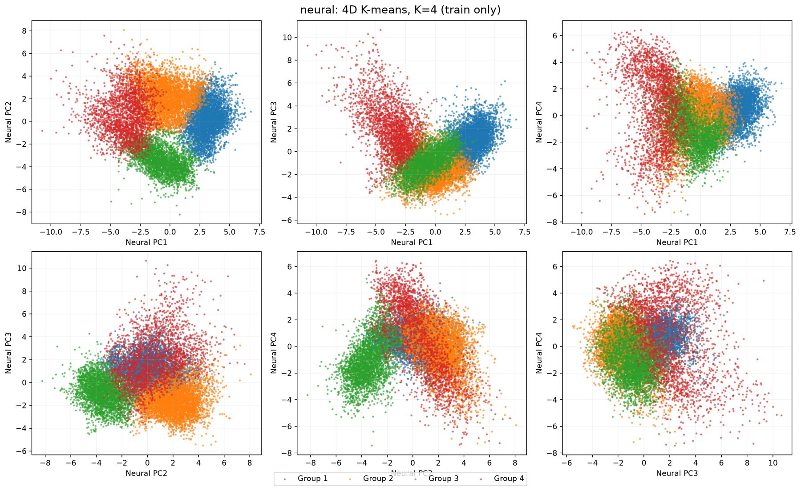
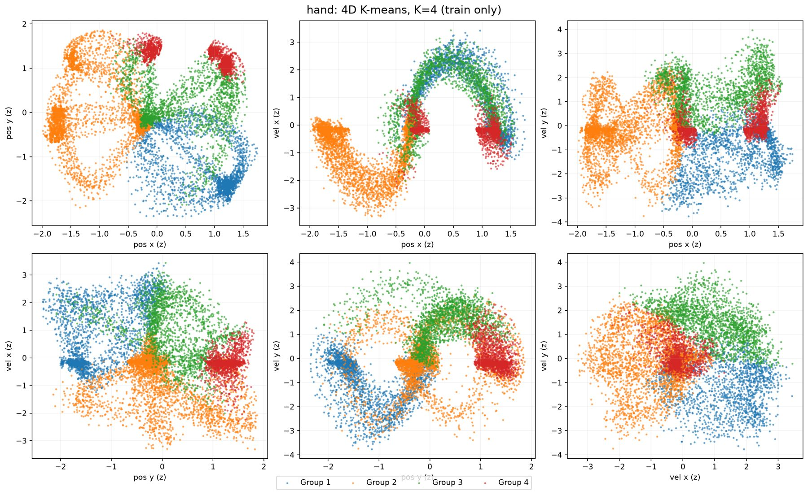

# DANDI 000138 · 四维硬聚类真实实验

- **状态**：已在官方 MC_Maze_Large NWB 上运行成功（非模拟数据）
- **实验运行**：[GitHub Actions 44055415908](https://github.com/noelabernathy400-bot/ot-hiwa/actions/runs/44055415908)
- **官方数据**：[DANDI 000138 0.220113.0407](https://dandiarchive.org/dandiset/000138/0.220113.0407)
- **数据文件**：`sub-Jenkins_ses-large_desc-train_behavior+ecephys.nwb`
- **完整实验工件**：GitHub Actions artifact `dandi-000138-hard-clustering-4d`（包含 PNG、CSV、NPZ、JSON）
- **源码依据**：用户上传的 `GCOT-reproducible-20261018.zip`；本仓库 `research/GCOT-reproducible-20261018/` 为提取后版本，原版 HiWA 与 GCOT 均单独保留

## 方法

以移动开始时刻 `move_onset_time` 为中心，从 -100 到 600 毫秒以 20ms 窗口汇总记录。神经域由 162 个神经单元的放电计数构建，在训练数据上拟合 PCA(4)。行为域直接使用实际 `hand_pos_x`、`hand_pos_y`、`hand_vel_x`、`hand_vel_y`，只做训练集拟合的标准化，**不做 PCA**。训练与测试按 trial 划分：500 个可用试次，400/100；分别得到 14,000/3,500 个时窗。两个域分别做无监督 KMeans(`k=4`，`seed=42`)；六张二维图是四维聚类结果在坐标平面的**投影**。

## 数值

| 训练集指标 | 神经域 X | 手部运动域 Y |
|---|---:|---:|
| Silhouette | 0.33961 | 0.37032 |
| 簇 0 样本数 | 4137 | 2818 |
| 簇 1 样本数 | 4316 | 6316 |
| 簇 2 样本数 | 3146 | 2012 |
| 簇 3 样本数 | 2401 | 2854 |

神经域四个 PCA 方差贡献率：4.47%、3.84%、2.55%、2.20%（累计 13.06%）。

## 真实簇图

> 图中两域各自的相同颜色**不表示**跨域簇对应。K-means 的 silhouette 只能用于评价各域内部划分，不能作为 Hard HiWA 正交对齐成功的证据。本轮**只做硬聚类，未运行 HiWA 对齐**。

## 后续检验

在启动 Hard HiWA 之前，建议增加跨域四维几何可对齐性诊断，判断是否存在足够接近的正交等距结构；神经四维 PCA 只解释约 13.06% 的输入方差，因此不可仅凭这几张图宣称两域结构相同。
